# Deja Vu1

**One screen for every U1 you run.** Deja Vu1 is a free, open-source
dashboard for the Snapmaker U1. You watch every printer live, start prints
from your phone behind a check the server enforces, get MakerWorld, NexPrint
and OrcaSlicer projects ready for the U1, and get a message when a print jams.
It runs on your own network, with no account and nothing to install but
Python.

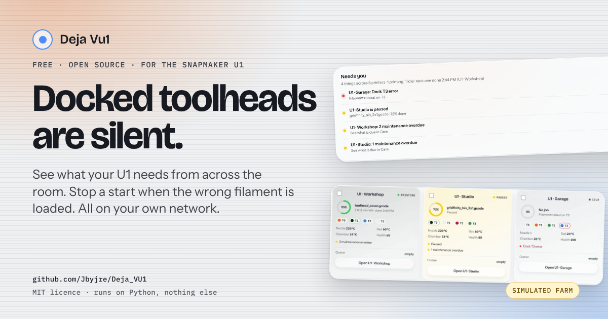

<sub>Every figure in the picture comes from the built-in simulated farm.</sub>

> **Looking for U1 owners.** Deja Vu1 has never talked to a real U1. If you own
> one and can spare 30 to 45 minutes, help run its first real connection. It's
> watch-only: you watch a print you're already running, and nothing is started
> or paused from Deja Vu1. **[How it works, and how to sign up](docs/first-connection.md)**

**See it first, with nothing to install:** the
[online demo](https://deja-vu1.jmath1110.workers.dev/?demo) opens the real
dashboard in your browser, playing a 2.5-minute recording of the simulated
farm (three U1s; one jams halfway). Click around: the digital twin, Files,
the mixed-nozzle planner and Photo Studio all work there; anything that would
change a printer says it's a recording.

**Try it in three lines** (Python 3.8 or newer; the first line needs git, or
use GitHub's **Code → Download ZIP** instead):

```bash
git clone https://github.com/Jbyjre/Deja_VU1.git
cd Deja_VU1
python3 backend/app.py
```

Then open **http://localhost:8000** and flip **Demo data** in the header for a
simulated farm of three U1s that heat, print and finish.

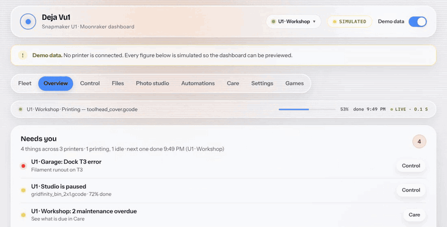

<sub>Live, on the simulated farm: a filament jam fired from the farm sandbox. The status ribbon turns to an error, a "print failed" alert appears, and the jam goes to the top of **Needs you**.</sub>

**Quick links:** [getting started](docs/getting-started.md) · [run it](#how-to-run-it) · [what's in it](#whats-in-it) ·
[how it connects](#why-one-dashboard-not-several-tools) · [current status](#current-status) ·
[security](#security-and-your-network) · [first connection](docs/first-connection.md) ·
[for developers](#for-developers-and-ai-coding-sessions)

Deja Vu1 runs a whole fleet of up to 12 printers, updates live four times a
second, and starts prints from your phone behind a real safety check. It
reads and edits print files in 2D and 3D, converts MakerWorld, NexPrint and
OrcaSlicer projects for the U1, skips one failed object while the rest of
the plate finishes, and runs local "when this happens, do that" automations
that reach your phone through ntfy, Discord or Telegram. Around that sit
printer control, a live engineering drawing of each printer, maintenance
tracking, filament and cost tracking, a photo-to-print studio, bridges to
Home Assistant, WLED and Spoolman, and ten games for while a long print
runs. It runs on Moonraker, the web API
that already sits in front of the printer: one application and one
connection per printer (a WebSocket for live state, plain HTTP requests for
commands, history and uploads), shared by every module.

It connects to a real printer by its Moonraker address, and has a
simulated farm for trying everything without one. The real connection was
written against Moonraker's, Klipper's and Snapmaker's own U1 source code
and tested against a stand-in built from that source, but it has not yet
talked to a physical U1 (see [Current status](#current-status)). Two
modules (the LED dock rings and the optical colour sensor) have complete,
tested logic waiting on physical parts.

Much of the code is written with [Claude Code](https://claude.com/claude-code),
and every change is in the public history.

## What's new

- **An online demo.** The public Cloudflare link now opens the real
  dashboard with a recording of the simulated farm, so anyone can see how it
  looks and works before installing it ([how it works](#the-public-page)).
- **The digital twin is a real drawing you can click.** Hidden edges,
  dimensions, a title block; click a toolhead for its nozzle, swaps and
  what the print needs from it.
- **Mixed-nozzle planner**: a different nozzle and layer height per
  toolhead, checked against Snapmaker's own limits, plus a nozzle check in
  Confirm Print.
- **Find printers on my network**, **Test** before adding, double-click
  starters for Windows, Mac and Linux, and a plain-language
  [getting-started guide](docs/getting-started.md).
- **Photo Studio** fits the photo's tones to your filaments, so hazy photos
  stop printing flat.

Everything, with what is and isn't verified: [CHANGELOG.md](CHANGELOG.md).

## Why it exists

You walk over to the printer to answer the same four questions. The printer
already publishes every answer; Deja Vu1 reads them for every U1 you run.

**Is it still printing?** Every printer updates four times a second, and
**Needs you** ranks what wants a person across the whole farm: a jam, a paused
print, a finished plate, an idle printer with work waiting. Automations send
it to your phone.

**Will this file print on a U1?** The pre-flight check flags extrusion outside
the 270 × 270 × 270 mm build volume, unknown toolheads and unsafe
temperatures, with line numbers. MakerWorld, NexPrint and OrcaSlicer projects
convert for the U1 in one click.

**Is the right filament loaded?** Four toolheads mean four chances to load the
wrong spool. Deja Vu1 compares the colour each toolhead was sliced for with
what the printer reports, and stops the start on a mismatch.

**Is it safe to press print?** Confirm Print pulls it together: pre-flight,
filament match, nozzles, spool weight, maintenance, time, grams and cost. The server
checks again at the moment of starting and refuses in words if something
changed, even when you start from your phone.

## What's in it

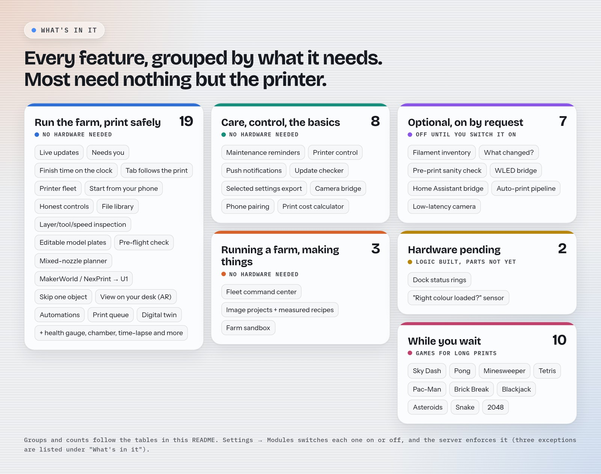

Every screenshot in this section comes from the built-in simulated farm (the **Demo data** switch), so every figure in them is simulated. The yellow banner and the **SIMULATED** badge in the app say the same.

### Run the farm and print safely: no hardware needed

| Feature | What it does |
|---|---|
| **Printer fleet** | **Find printers on my network** adds a U1 without typing an address (it asks the network, then tries Moonraker's port on your home network, and checks each one); **Test** checks a typed address first. Every printer at a glance: state, progress, the filament in each dock, temperatures, alerts and a health score. One tap points the whole dashboard (maintenance, control, cost, queue, everything) at any of them. |
| **Live updates** | Printer state refreshes every 250 ms, the same rhythm Klipper itself reports at, so nothing could be fresher. It is pushed to the browser over a WebSocket written from scratch in standard-library Python. If the WebSocket fails three times (a network that blocks it, or a server restart), the dashboard asks once a second instead, says so, and tries the WebSocket again every 30 seconds. |
| **Needs you** | The top of the Overview ranks every printer by what wants a person: a fault the printer reported, a paused or finished print, an idle printer with files waiting, overdue maintenance, or a print finishing within 15 minutes. Each comes with a button straight to the right tab. When nothing does, it says so, with how many are printing and when the next one finishes. |
| **Start a print from your phone** | Pick a file, read one Confirm Print summary (pre-flight check, filament match, nozzles, spool weight, maintenance, time, grams and cost) and start it. The server re-checks at the moment of starting and **refuses** if something is wrong. |
| **Pre-flight risk check** | Flags extrusion outside the U1's 270 × 270 × 270 mm volume, the nozzle below the bed, unknown toolheads, unsafe temperatures, travel moves below plastic already printed, and more, with line numbers. A file still numbering a filament add-on's extra slots (multiACE's T4–T15) is told to run that add-on's post-processor first; its rewritten file passes. |
| **Mixed-nozzle planner** | A different nozzle and layer height on each toolhead: fine detail on a 0.2 mm nozzle, thick fast layers on a 0.8. Pick each head's nozzle and height (they start from what the printer reports fitted) and it works out the shared layer grid, how many grid layers each head spans and how many layers a part needs, checks every height against Snapmaker's own U1 profile limits, and draws a section through the layers. The grid rule follows the published description of a U1 Orca fork's per-extruder layer height option. **Confirm Print** now also refuses a file sliced for a nozzle the toolhead doesn't have fitted. |
| **MakerWorld / NexPrint / OrcaSlicer → U1** | One click turns a Bambu Studio (MakerWorld), Elegoo Slicer (NexPrint) or OrcaSlicer project into one set up for the Snapmaker U1 in Snapmaker Orca, keeping the creator's own settings and colours. **Multi-plate projects land on the right plates**: every plate's objects are moved onto the U1's own plate grid, written from Snapmaker Orca's source. When it can't convert, it says why with a code, the step it failed at and what to try, and **Copy report** puts a full report on the clipboard for a bug report. |
| **Skip one object** | When one part on a full plate fails, skip just that one and let the rest finish (Klipper's `exclude_object`, which Snapmaker's U1 profiles switch on). The Control tab draws the plate from above like a drawing sheet: each part outlined with a numbered balloon that matches the list, the one printing now in blue, skipped ones section-hatched, the bed dimensioned. Pick one, confirm, and only that one stops. |
| **Print queue** | Files to print one after another. Each one passes the same Confirm Print check before it starts; anything that doesn't pass waits, with the reason. |
| **Automations** | Local rules: a temperature crosses a line, a print starts / pauses / finishes / fails, the wrong filament is loaded, maintenance is overdue → send a notification, set a WLED light, set a Home Assistant sensor, or pause the print. Every firing is logged with what really happened. |
| **Digital twin** | A live engineering drawing of each printer, drawn the drafting way: one ink, hidden edges dashed, the build volume as a phantom line, real dimensions and a title block with its scale. The bed drops as each layer is added, the toolhead and gantry move, the parts on the plate come from the file's own object outlines (a skipped one is crossed out), and the four rear docks carry balloons with each head's filament. **Click a toolhead** for its temperature, filament, nozzle size, lifetime swaps, retries and failures (from the U1's firmware) and what the running print needs from it; click a part for its size and a shortcut to skip it; click the bed for its temperature and height. 3D, front and top views; drag to turn. |
| **File library** | Your G-code, 3MF and STL files, with real thumbnails, estimated time and grams, a pre-flight verdict, and a recent list. |
| **Interactive 3D viewer** | The toolpath of any G-code file, scrubbable layer by layer, and any STL or 3MF model, drawn with plain WebGL and parsers written for this project, no 3D library. |
| **G-code viewer + small edits** | Read the file line by line, search it, change one number, comment a line out or insert one command, each edit validated first (no emergency-stop lines, no toolheads the U1 doesn't have), the original kept, the pre-flight re-run. |
| **Honest controls** | Every button says what it's sending straight away ("Pausing…"), then shows only what the printer actually reports back. A command the printer refuses is shown as refused, in words, never as done. |
| **Finish time on the clock** | Alongside "2 h 17 min left", every running print says when it will finish ("done 2:42 PM", "tomorrow 1:05 AM") on the status ribbon, the fleet cards and the live pill, from the same estimate. |
| **The browser tab follows the print** | The page title mirrors the selected printer, "53% · U1 · Workshop · Deja Vu1" (or Paused, Finished, Needs attention), and the tab's icon draws the progress ring, so a background tab still tells you how it's going. |
| **View on your desk (AR)** | Places an STL or 3MF model on your real desk at its real printed size, through the phone's camera. Works on Android/WebXR browsers; iOS Safari has no equivalent. The button only appears where AR is supported, and it needs an `https://` address, such as the Cloudflare Tunnel. See [docs/ar-preview.md](docs/ar-preview.md). |
| **Print health gauge, chamber climate, time-lapse flipbook, celebration card, "continue on another device", calibration reminder after a nozzle swap, weight-based filament forecast, side-by-side settings diff, 28 Home Assistant sensors, MJPEG camera relay** | The supporting cast, see [docs/architecture.md](docs/architecture.md). |


<sub>**Overview:** the status ribbon with progress and finish time, then **Needs you**, ranking everything that wants a person across all three printers.</sub>


<sub>**Fleet:** every printer's state, progress, filament per dock, temperatures and health, with controls to command several at once.</sub>


<table>
<tr>
<td width="50%" valign="top">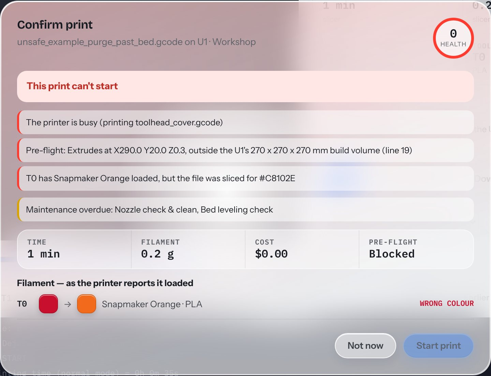<br><sub><b>Confirm Print, refusing:</b> the built-in unsafe example file, with every reason in words and the start button disabled.</sub></td>
<td width="50%" valign="top"><br><sub><b>A file, opened:</b> the toolpath in 3D, the slicer's estimates, the pre-flight verdict and the G-code, searchable and editable.</sub></td>
</tr>
</table>

<table>
<tr>
<td width="50%" valign="top">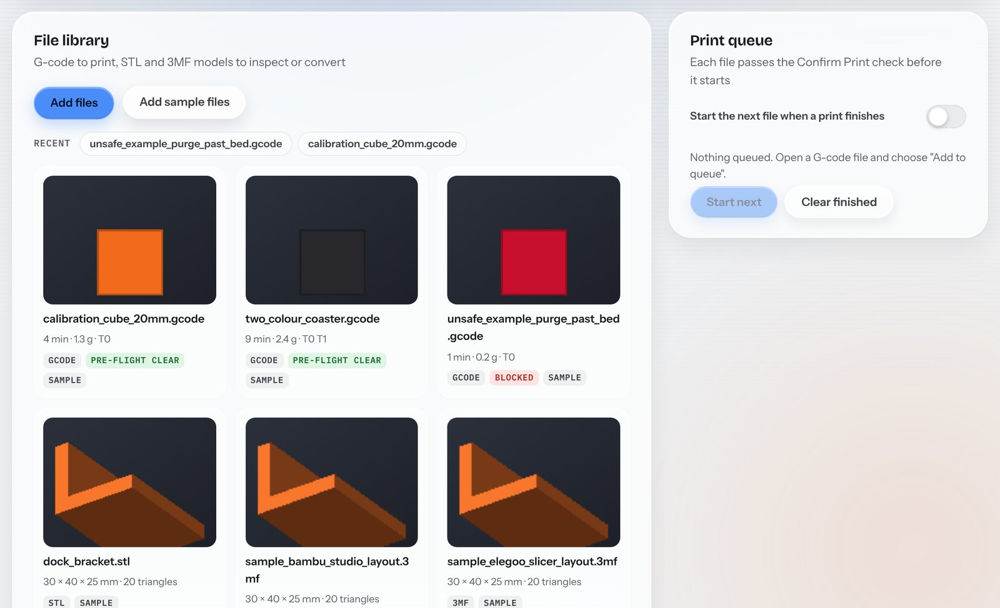<br><sub><b>Files:</b> thumbnails and estimates, a pre-flight badge on every G-code file, and the print queue beside them.</sub></td>
<td width="50%" valign="top"><br><sub><b>Automations:</b> "when this happens, do that", built from a ready-made example, with every firing logged.</sub></td>
</tr>
</table>

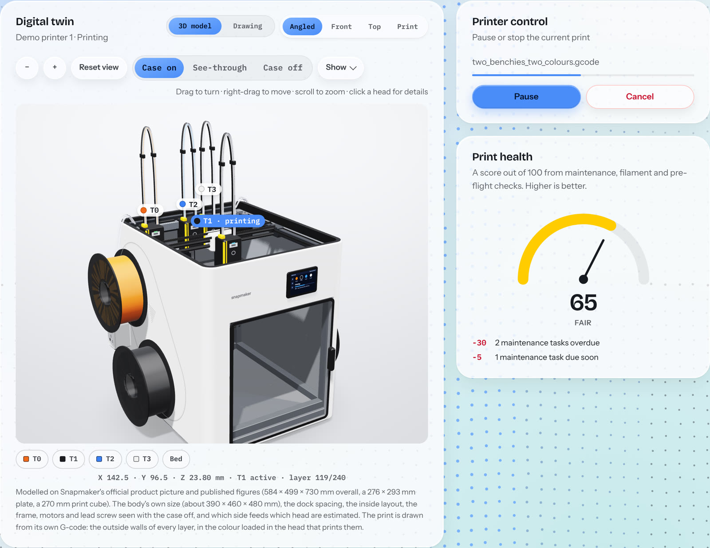

<sub>**Digital twin, print health and chamber climate:** a live engineering drawing of the printer (the bed dropping as layers build, the head moving, the parts on the plate, the four docks), one health score with every deduction listed, and the chamber temperature over time.</sub>

<table>
<tr>
<td width="42%" valign="top">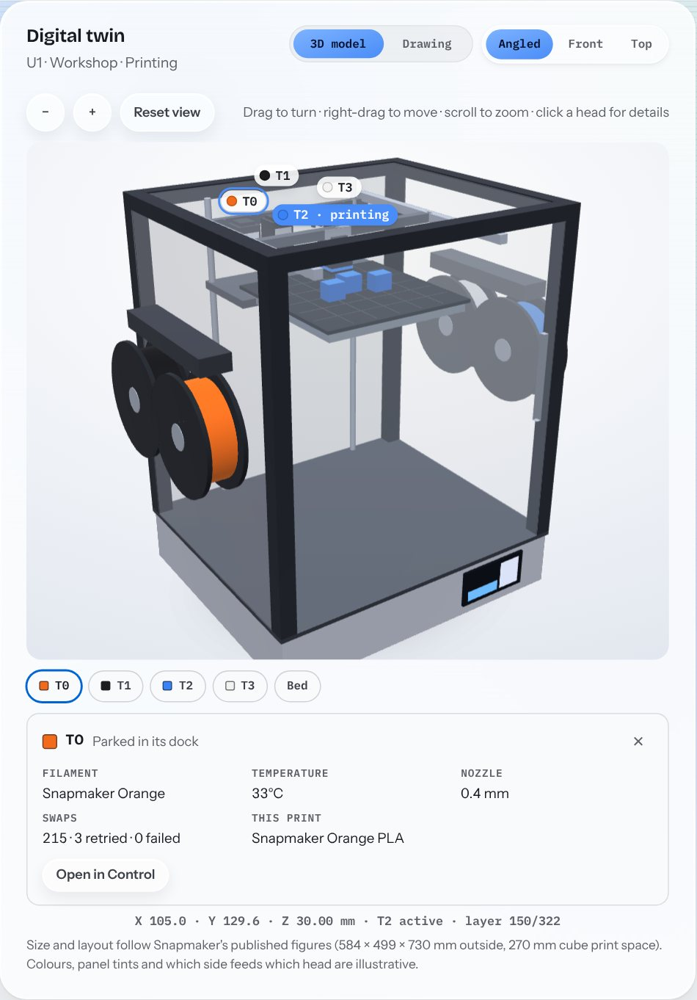<br><sub><b>Click a toolhead:</b> its nozzle, swaps and what this print needs from it.</sub></td>
<td width="58%" valign="top">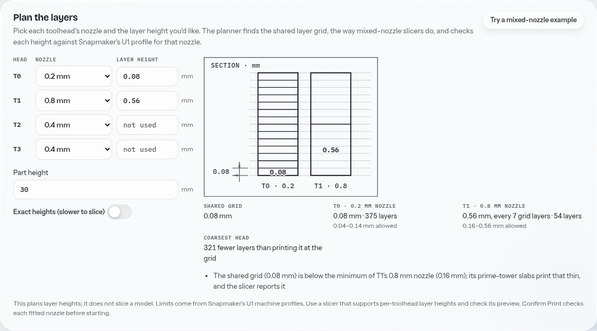<br><sub><b>Mixed-nozzle planner:</b> the $5,000 winner's idea, checked against Snapmaker's own limits.</sub></td>
</tr>
</table>

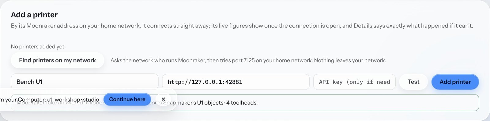

<sub>**Add a printer:** find it on the network, or test a typed address before adding it.</sub>

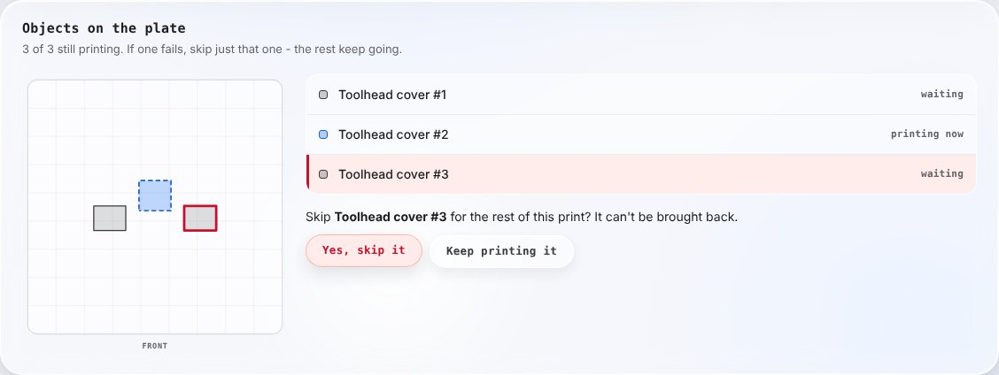

<sub>**Skip one object:** pick the failed part on the plate map, confirm, and the rest keep printing.</sub>

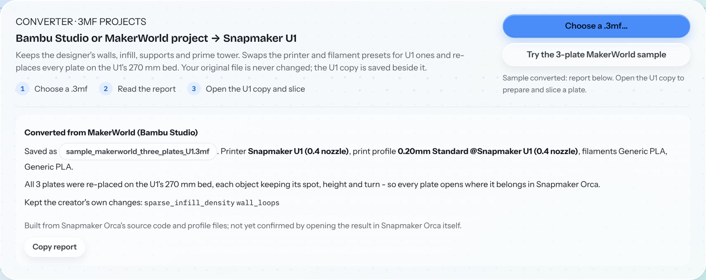

**Converting a MakerWorld project:** every plate lands where Snapmaker Orca
expects it, the creator's own setting changes are kept and listed, and the
report says what wasn't checked yet (the result hasn't been opened in
Snapmaker Orca itself).

<br clear="right">

### Care, control and the basics: no hardware needed

| Module | What it does |
|---|---|
| **Maintenance reminders** | Seven tasks. Six track cumulative hours, print counts or calendar time since they were last done (nozzle, bed, belts, rails, dock alignment, fans); the seventh, recalibration, comes due when you record a nozzle or hotend swap. Each resets when you mark it complete. For a real printer, counting starts from its totals on first connection. |
| **Printer control** | Pause, resume, cancel, set a toolhead's target temperature, home an axis, or send a raw G-code line, with a live console log. |
| **Push notifications** | Alerts via ntfy.sh, Discord, or Telegram, plain webhooks, no SDK, no account. They're sent by the rules you set in **Automations** (it offers ready-made ones such as "Tell me when a print finishes"). A rule marked urgent always sends; a normal one waits out your quiet hours instead of buzzing your phone at 3am. |
| **Update checker** | Reads Moonraker's own update-status API and flags when Klipper or Moonraker have an update waiting. |
| **Config backup** | One-click zip of the module switches, the filament list, notification settings (secrets blanked) and the default simulated printer's maintenance log. Not yet included: real printers' maintenance logs, the printer list, automations, the queue and the other settings; there is no restore yet. |
| **Camera bridge** | Brings the printer's camera feed in, with a watchdog that flags a frozen stream instead of silently showing a stale image. |
| **Phone pairing** | A short one-time code, entered on a second browser, adds it to a paired-devices list, no account, no password, nothing that leaves your network. It's a convenience list, not a lock: see [security](#security-and-your-network). Always on. |
| **Print cost calculator** | Prices filament by material and adds electricity, for a print in progress and for recent history. $/kg per material, $/kWh and printer wattage are editable. |

<table>
<tr>
<td width="50%" valign="top">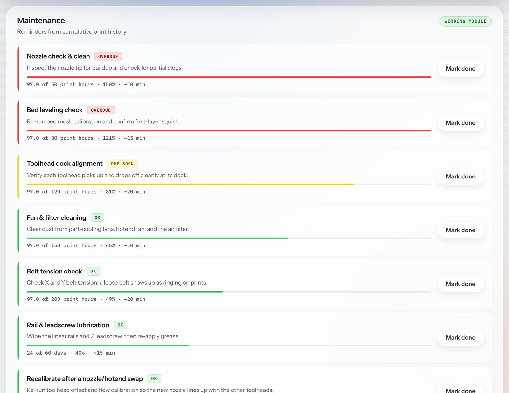<br><sub><b>Care:</b> each maintenance task with how far it has run, overdue ones in red.</sub></td>
<td width="50%" valign="top">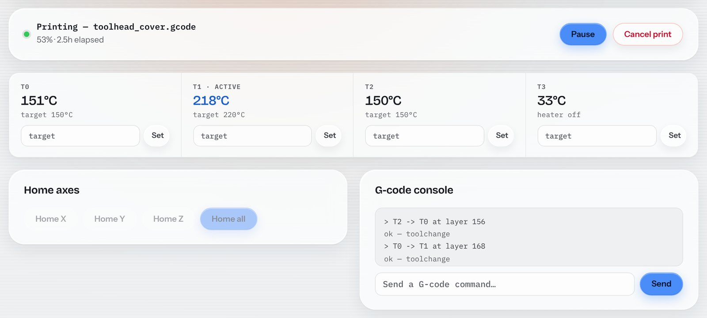<br><sub><b>Control:</b> the running print, all four toolheads' temperatures, homing and a G-code console.</sub></td>
</tr>
</table>

### Running a farm, and making new things: no hardware needed

| Feature | What it does |
|---|---|
| **Fleet command center** | Tick several printers in the Fleet tab and preheat, pause, resume, home or cancel them together. The commands go out in parallel through the same per-printer controls as everywhere else, and every printer's result is read back and listed separately ("Pause: 2 of 3 confirmed; failed on U1 · Garage", with each printer's reason, such as "Nothing is printing right now", in its own row), never a blanket "done". Drag a G-code file (or a waiting queue item) onto any printer to put it on that printer's queue. A farm history panel shows prints, completed vs. failed, and material per day or week, per printer and for the whole farm, summed from each printer's own history. |
| **Photo-to-Print Studio** | Drop in a photo and get a colour-layered relief model (the well-known "HueForge" technique) in up to four filament colours: the spools in your inventory, or colours you pick. It models how light passes through thin layers of each filament, picks each pixel's height to match the photo, chooses where each colour starts, previews the result in 2D and in the 3D viewer, and saves a watertight STL or a 3MF carrying the tool changes. Change a colour, a size or a layer setting and the model rebuilds by itself; until it has, the old one is greyed out and can't be saved, so what you save always matches what's set. It fits the photo's light and dark to what your filaments can actually show (a hazy photo used 11 of 25 possible heights before, all 25 now), says when a colour isn't reached and leaves its pointless tool change out. When the match is rough it says which colour would help. It all runs in the browser; the photo is never uploaded. |
| **Farm sandbox** | A simulated farm of up to 27 printers, with scripted scenarios (a jam mid-print, a runout, a heater fault, a network drop, the wrong filament loaded, maintenance going overdue) and a clock you can play, speed up, or step forward. Everything else in the dashboard (fleet, automations, queue, notifications, history) reacts, because the sandbox drives the same simulated printers they all read. Demo data only. |

<table>
<tr>
<td width="50%" valign="top"><br><sub><b>A bigger farm:</b> the three built-in printers plus six added in the sandbox.</sub></td>
<td width="50%" valign="top">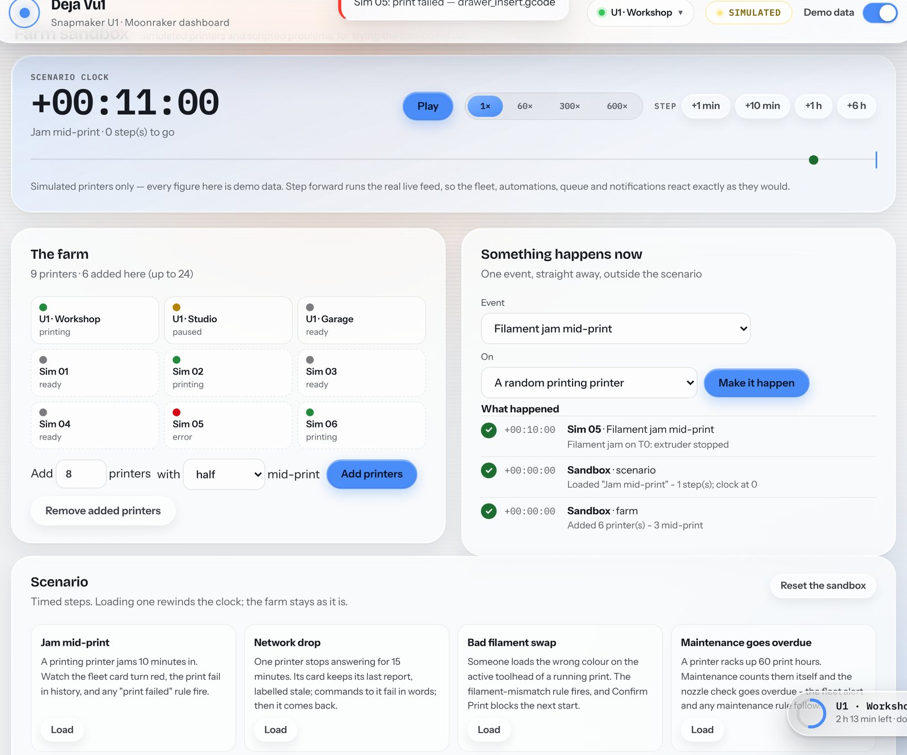<br><sub><b>Farm sandbox:</b> the "Jam mid-print" scenario on its clock, one-off events, and a log of what happened.</sub></td>
</tr>
</table>

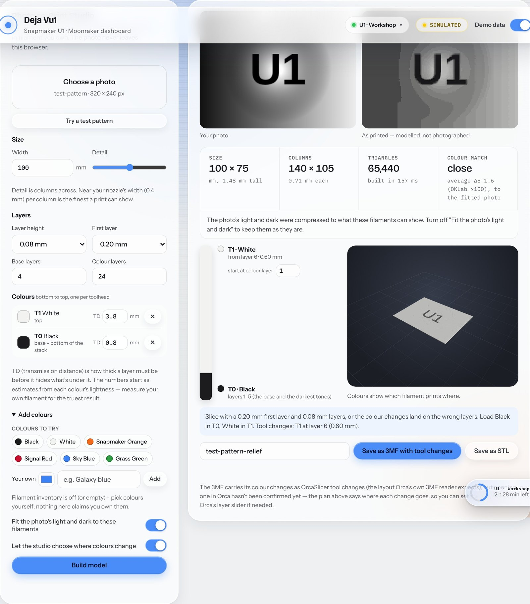

<sub>**Photo-to-Print Studio:** the built-in test pattern turned into a layered relief. The right-hand preview is modelled, not photographed.</sub>

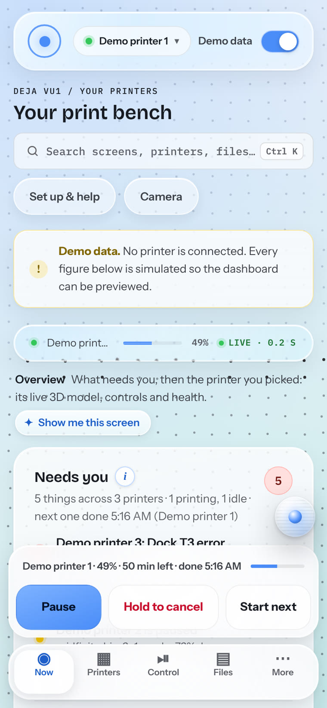

On a phone the layout is rebuilt thumb-first: the main sections and the
Pause / Hold-to-cancel / Start-next controls sit at the bottom of the
screen, with the print's progress on a line just above them on every tab.
Pair a phone from **Settings → Pair another device**: it gets a short code,
and talks straight to your computer over your home network.

**Add to Home Screen** gives it a proper icon and name, opening without the
browser's bars where the phone allows.

<br clear="right">

### Optional: on by request

| Module | What it does |
|---|---|
| **Filament inventory** | Tracks spools on hand, flags print files needing a colour you don't have, and nudges you if a spool has sat loaded for weeks. **Import from Spoolman** brings in the spools you already track in [Spoolman](https://github.com/Donkie/Spoolman), with their colour and grams left; importing again updates them instead of duplicating. |
| **What changed?** | Compares the job about to print against your last few runs of that file, and flags a likely cause when the file has failed before and shares a pattern (a filament type in common, say). |
| **Pre-print sanity check** | Combines maintenance, dock status, and colour-check into one "safe to print?" verdict. |
| **WLED bridge** | Pushes dock ring colours to a WLED-flashed LED strip you already own, over WLED's own JSON HTTP API, no extra hardware to build. |
| **Home Assistant bridge** | Publishes printer state as a handful of REST sensors, so it shows up on an existing HA dashboard, no MQTT broker, no custom component. |
| **Auto-print pipeline** | Slices STL and 3MF models with [OrcaSlicer](https://github.com/SoftFever/OrcaSlicer), **a separate program you install yourself**, using Orca presets you choose; the G-code lands in the file library, or straight on a printer's queue, where it still passes Confirm Print before it starts. Off by default. Driving another program from outside is fragile, an Orca update can change its command line, so every slice has a time limit, is checked for real printable layers before it's kept, fails in words with Orca's own message, and records the Orca version that made it. |
| **Low-latency camera (WebRTC)** | Plays the camera with almost no delay through [go2rtc](https://github.com/AlexxIT/go2rtc), **a separate program you install yourself**. It's one step beyond "nothing to install", so it's off by default. MJPEG stays the default, and the dashboard falls back to it automatically, saying which feed is on. See [docs/low-latency-camera.md](docs/low-latency-camera.md). |

### Interface + simulation, hardware pending

| Module | What it does |
|---|---|
| **Dock status rings** | A ring of light beside each toolhead dock: soft white for ready, pulsing green with a progress arc for printing, pulsing amber for heating, blue for paused, blinking red for a fault. It is readable across the room. Two ways to build it: WS2812 rings, or push the same state to a WLED-controlled strip you already own. |
| **"Right colour loaded?"** | An optical sensor in the filament path, compared against what the print file expects, catching the wrong spool before the print starts. |


<sub>**Dock status rings, on screen today:** what each LED ring would show. The physical rings are waiting on hardware.</sub>

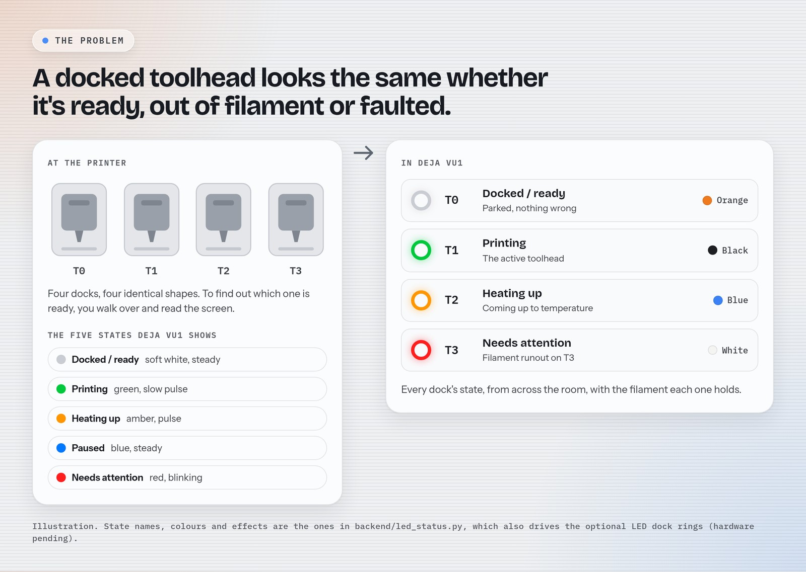

<sub>**Why dock status matters:** a parked toolhead looks the same whether it's ready, out of filament or faulted. Deja Vu1 shows each dock's state on screen today, and on the rings once they exist.</sub>


Every module can be switched on or off from **Settings → Modules**: the
toggle you see there is enforced by the server, not just hidden in the
interface: a disabled module's API routes refuse to answer rather than
silently doing nothing. Three exceptions, said plainly: switching a module
off doesn't yet stop work already running in the background (automation
rules, queue auto-advance, time-lapse capture, filament deduction); "View on
your desk" has no server routes, so its switch is enforced in the browser;
and phone pairing can't be switched off.

<br clear="right">

### While you wait (the Games tab)

Ten games, playable from the dashboard while a long print runs: **Sky
Dash**, **Pong**, **Minesweeper**, **Tetris**, **Pac-Man**, **Brick Break**,
**Blackjack**, **Asteroids**, **Snake** and **2048**. None of them read the
printer; the status strip and the live print pill stay visible on every
tab, including mid-game, so a finished or failed print is never missed.
Best scores are remembered per browser.

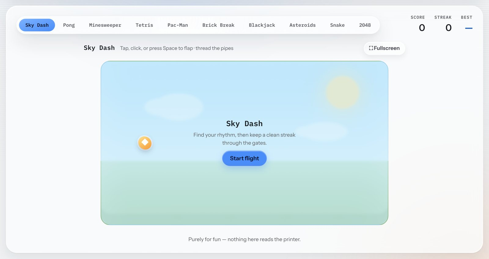

## Why one dashboard, not several tools


Everything reads from the same Moonraker connection and the same print
history. Splitting that into separate tools would mean separate connections,
separate setups, and separate tabs to check. They are modules of one
application because the data says they should be, and it means the modules
that need hardware never block the ones that don't. Maintenance and printer
control work now, on any Moonraker-connected printer. The LED and colour
modules switch on when their parts arrive.

## No printer, no numbers

The dashboard does not invent figures. With no printer connected it shows
empty states: not zeroes, not placeholder data dressed up as real readings.

To preview it, there is a **Demo data** switch in the header. Turning it on
loads simulated print history and labels every panel accordingly, with a
banner saying plainly that nothing is connected.

This is enforced in the server, not just hidden in the interface. Without a
printer and without an explicit demo request, the data endpoints return
`{"connected": false, "demo": false}` and nothing else. `curl` gets the same
answer the browser does. Settings that belong to the dashboard itself
(modules, pairing, notification preferences, the filament list) aren't
printer figures, so they work the same with or without a printer connected.

## Current status

**The real printer connection exists and is tested, against the source,
not against a machine.** `backend/moonraker_client.py` talks to Moonraker
over HTTP and its WebSocket and translates what it says into what every
module already reads. It was written from Moonraker's, Klipper's and
Snapmaker's published U1 source, and reading that source found and fixed
about a dozen things that would each have broken the first real connection
(state names, partial live updates, commands that answer "ok" before the
printer has moved, the U1 refusing a start with a "successful" reply,
temperatures reaching the wrong toolhead through the U1's filament mapping,
history paging, millimetres vs grams, the U1's own metadata names, and
more). It is tested against a stand-in Moonraker built from the same
source, over real sockets, and the whole dashboard runs against it with a
printer added through the API. **It has not talked to a physical U1**: the
first connection is where any difference between the published source and
a real machine shows up, and the printer's **Details** panel and the server
log are built to make that first run easy to debug. Everything checked,
everything not yet checkable, and why: [docs/real-printer.md](docs/real-printer.md).

**October 2026 audit.** A full read of the code against this README
found and fixed: a way for a crafted print file's metadata to run script in
the dashboard (now escaped, and file colours validated); a gap that let a
web page on the same computer slip past the address check with a forged
header (a Cloudflare Tunnel's domain now has to be listed, see
[security](#security-and-your-network)); a real printer's maintenance
reading as overdue on its very first connection; a print already running
when the dashboard connects being announced as "started" (firing
time-lapse and "print starts" rules); an upload cut off part-way being
saved as a file; dock rings showing "heating" for a faulted printer; the
hidden game swallowing the space bar in every text box; a removed printer
staying selected; the live feed staying on slow polling after a server
restart; the accessibility settings not reaching the cards; and several
smaller ones. Each has a test in `tests/test_audit_fixes.py`. What it found
and didn't fix yet is listed in [CLAUDE.md](CLAUDE.md#known-open-issues-found-in-the-october-2026-audit-not-fixed-yet).

The same pass hardened the rest for real conditions:

- The G-code pre-flight check reads every line the way Klipper will. Before,
  a file could hide an out-of-bounds extrusion from it (`G1X300E5` with no
  spaces, a leading line number, relative moves under `G91`, an arc
  bulging past the bed) while the printer would still have run it.
- Models are read as a stream: a zip bomb or a damaged 3MF is refused in
  words, and the largest STL an upload allows takes ~120 MB instead of
  ~1.5 GB (enough to crash a small Raspberry Pi before).
- WLED, Home Assistant, ntfy, Discord and Telegram were each checked against
  their own source or docs. Fixed: only the first WLED ring ever lit, long
  printer messages were refused by Home Assistant, Discord could drop
  messages silently, and notifications held during quiet hours were never
  sent.
- Races that only appear when commands take real time: a slow upload froze
  every print queue, two devices could start two prints at once, and a
  queue item could be moved and started at the same time.
- Unsafe things the simulation allowed are now refused: homing while a
  print runs, and a farm-wide "preheat" rewriting running prints'
  temperatures. Demo data can never reach a real printer.

- The live engine, the fleet, start-print with its interlock, the file
  library, G-code viewer and editor, 3D viewer, pre-flight check, the
  converter, automations, the queue, the digital twin, health gauge,
  chamber panel, time-lapse, celebration card and handoff are complete,
  covered by tests, and were played through in a real (headless) browser
  on desktop and phone sizes, including touch.
- The simulation is now a fleet of three U1s (Workshop, Studio, Garage),
  each with its own history, and it moves: hotends heat toward their
  target, prints progress and finish, the toolhead travels. Demo controls
  can fast-forward it, restart it, or make the next command fail on purpose
  to show how a failure is reported.
- Not verified yet, and said so: the converter's output hasn't been opened
  in Snapmaker Orca itself. Getting Orca running here was tried and blocked
  (see [docs/architecture.md](docs/architecture.md#conversion)). Instead,
  every converted project is checked by a test against the rules in
  Snapmaker Orca's loader source and a snapshot of Snapmaker's real U1
  profiles. That check caught and fixed one real bug. Nothing has touched a
  real Moonraker (only a stand-in built from its source), a real camera,
  a real go2rtc (its API was checked against go2rtc's source; a password-
  protected one now works), or a real Cloudflare Tunnel. The AR preview has
  only run against a stand-in for a phone's WebXR, never on a real device.

- The fleet command center, Photo-to-Print Studio, auto-print pipeline and
  farm sandbox are complete and covered by tests, and were clicked through
  in a real (headless) browser at desktop and phone sizes. What isn't
  verified yet, and said so: the auto-print pipeline has only run against a
  stand-in program that behaves the way OrcaSlicer's source code says Orca
  does (the command line was read from Orca's source, v2.3.2 and main),
  never against a real Orca install. A studio 3MF's tool changes use the
  layout Orca's own 3MF reader expects, but one hasn't been opened in Orca
  yet. The studio's colour preview is a light-absorption model with
  estimated filament transmission values, not a photo of a print.

- Maintenance, printer control, notifications, updates, backup, camera
  watchdog, pairing, and the print cost calculator are complete and tested,
  against the simulation and (through the real Moonraker client) against
  the stand-in Moonraker. Nothing outside `backend/mock_moonraker.py` and
  `backend/moonraker_client.py` talks to Moonraker (the camera relay reads
  the stream address you set in the camera settings).
- Filament inventory, the What-changed check, and the pre-print sanity check
  are complete and tested; they're optional and off by default.
- The WLED and Home Assistant bridges are complete outbound HTTP clients,
  tested against stand-ins that follow WLED's and Home Assistant's own
  source (not yet against a real strip or a real Home Assistant); leave the
  host or URL blank, or point them at something unreachable, and they fail
  in words instead of pretending.
- The LED and colour-check modules have working decision logic and console
  simulations, but no hardware drivers yet.
- `backend/mock_moonraker.py` generates fake print histories (38 jobs over
  about two months for the first printer) and live state that pause /
  resume / cancel / start and temperature changes genuinely change.

I do not own a Snapmaker U1. The project hasn't been entered in the Snapmaker
Innovation Fund yet; the plan is to enter Phase 2, partly to request a unit.
Until then, [first connections](docs/first-connection.md) on owners' printers
are how it gets tested on real hardware. Everything that can be built without
the machine has been built; the rest is designed and documented so it can be
finished quickly once hardware is available.

Both hardware modules are deliberately non-invasive, external add-ons that
mount to the frame and read printer state over the network. Nothing is
soldered to the mainboard and no firmware is modified. The U1's sealed
Rockchip SoC exposes no GPIO, so this is both a design requirement and the
only sensible approach. Details in
[docs/hardware-modules.md](docs/hardware-modules.md).

### Status at a glance

| Part | Works with demo data | Tested against a stand-in built from the real thing's source | Confirmed on real hardware |
|---|---|---|---|
| Live dashboard, fleet, controls, start-print interlock | Yes | Yes - Moonraker, Klipper and Snapmaker's U1 source | Not yet - no U1 here |
| Skip one object | Yes | Yes - Snapmaker's u1-klipper `exclude_object` | Not yet |
| Nozzle sizes and swap counts per toolhead | Yes | Yes - u1-klipper `extruder.get_status` | Not yet |
| Mixed-nozzle planner, nozzle check in Confirm Print | Yes | Limits from Snapmaker Orca's U1 profiles; grid rule from a published description, not checked against a real slice | Not printed yet |
| Find printers, Test | - | Yes - u1-moonraker's mDNS announcement and Moonraker's HTTP API | Not on a real network with a U1 yet |
| Double-click starters | - | Linux | Windows and Mac not run yet |
| Online demo (Cloudflare link) | Recorded from it | Checked in Chromium on a plain static server, like Cloudflare's | The published link itself not opened from here (the build sandbox can't reach it) |
| Filament colours after a touchscreen change | - | Yes - asked for every 30 s as well as pushed | Not yet |
| MakerWorld / NexPrint / OrcaSlicer converter | Yes | Checked against Snapmaker Orca's loader and plate-grid source | Output not yet opened in Snapmaker Orca |
| Photo-to-Print Studio | Yes | Runs in the browser; STL checked watertight | 3MF not yet opened in Orca, no print yet |
| Spoolman import | Yes | Yes - Spoolman's API source | Not against a running Spoolman |
| WLED, Home Assistant, ntfy, Discord, Telegram | Yes | Yes - each one's own source or docs | Not yet |
| Auto-print slicing (optional) | Yes | A stand-in that behaves like OrcaSlicer's command line | Not against a real Orca install |
| Low-latency camera (optional) | - | go2rtc's source | Not yet |
| LED dock rings, colour sensor | Simulated | Decision logic tested | Hardware pending |

If you have a U1 and want to help close the last column, see
[docs/beta-testing.md](docs/beta-testing.md).

## Thanks

Thank you to the Snapmaker U1 community and to the Phase 1 winners of the
Snapmaker Innovation Fund, whose public work showed what U1 owners need.
The U1-specific behaviour is written from Moonraker's, Klipper's and
Snapmaker's own source and documentation.

## Tech stack


- **Backend:** Python, standard library only, written for 3.8 or newer;
  the test suite passes on 3.8, 3.10, 3.12 and 3.13 in GitHub Actions
- **Web server:** `http.server` from the standard library (the threading
  version), plus a hand-written RFC 6455 WebSocket for live updates
- **Frontend:** HTML, CSS, and JavaScript, no framework, no build step;
  raw WebGL for the 3D viewer, the browser's own `DecompressionStream` to
  unzip 3MF files
- **Storage:** plain JSON files
- **Tests:** `unittest` from the standard library, 638 cases
- **Printer API:** Moonraker, over HTTP and its WebSocket (and a simulated
  farm for demo data)

No dependencies. Nothing to install beyond Python itself, and nothing is
fetched from the internet at runtime; the three typefaces ship inside
`frontend/fonts` (SIL Open Font License, licences alongside), no CDN, no
analytics.
(Reaching it from outside your home uses Cloudflare's own `cloudflared`
program, which you install separately if you want that; see
[docs/remote-access.md](docs/remote-access.md). The optional low-latency
camera works the same way: it uses go2rtc, which you'd install yourself;
see [docs/low-latency-camera.md](docs/low-latency-camera.md). The optional
auto-print pipeline is the same again: it runs an OrcaSlicer you install.)
It works offline, including the phone pairing, which talks directly to this
server over your local network rather than through any cloud relay.

The interface uses an Apple Liquid Glass treatment: translucent panels with
real edge refraction (an SVG displacement filter, not just a blur), a
specular highlight that tracks the pointer, a bright rim, and elevation
shadow: the five layers that separate genuine glass from a blurred box.
The real refracting glass sits on the navigation and floating layer, top
bar, tab bar, live print pill, menus, sheets and dialogs, the things content
scrolls under. Content cards keep the same tint, highlight, rim and shadow
but don't blur what's behind them: behind them is only the soft background
glow, where a blur looks the same and costs real work every frame. Repeated
small panels share one surface with plain dividers for the same reason. It
respects the system settings for reduced transparency, reduced motion, and
increased contrast, and the layout collapses cleanly to a phone-width screen.

Liquid Glass 2.0 adds four things on top: panels **morph**: a sheet of
glass deforms on a spring from one element into another (a printer card
into the overview, a file into its detail view, a button into its dialog,
the active tab sliding along the tab bar); on the live print pill and the
digital twin the highlight **drifts gently even at rest**; glass laid over glass (dialogs) uses a
**deeper refraction**, so what's underneath visibly bends more than the
background; and panels **take a tint** from what they're about: the active
filament's colour, a printer's state, a verdict.

The current look, "Layer lines" (`frontend/theme.css`, loaded last so it
changes appearance, never layout): behind everything runs a field of fine
horizontal lines, like the side wall of a print, lit by soft light in the
colours of the filament actually loaded on the printer you're looking at.
Glass is kept for the controls: header, tab bar, status ribbon, phone
dock, live pill, menus and dialogs. The tab bar and ribbon are clear
enough that the lines visibly shift where the glass bends them. Cards are
content, so they sit on a quieter frosted "paper" with no lensing (Apple's
own rule, and far fewer live filters on a big sandbox farm). Type is
Bricolage Grotesque for headings and big numbers, Instrument Sans for
reading and buttons, IBM Plex Mono for readings and labels.

## Security and your network

**Deja Vu1 has no login.** Anyone who can reach its port can pause or
cancel a print and send G-code, so keep it on a network you trust. Phone
pairing is a list of remembered devices, not a lock. What it does defend
against:

- **Other names pointed at it.** It only answers requests addressed to a
  name that belongs to your own network: an IP address, `localhost`, a
  plain machine name, or one ending in `.local`, `.lan`, `.home`,
  `.internal`, `.home.arpa`, `.localdomain` or `.ts.net`, plus any name you
  list in `DEJAVU_ALLOWED_HOSTS`. Anything else gets "Refused" (HTTP 421).
  This blocks *DNS rebinding*, where a web page you visit points its own
  domain at your dashboard to control it from your browser.
- **Other sites sending commands.** Every command and the live connection
  are refused (HTTP 403) when the browser says they come from another site.
- **Being framed.** No other site can load the dashboard invisibly inside
  its own page.

To reach it away from home, use a Cloudflare Tunnel with Cloudflare Access
in front, and list the tunnel's name in `DEJAVU_ALLOWED_HOSTS`. See
[docs/remote-access.md](docs/remote-access.md).

## Settings and your data

The server listens on every network interface of the computer, on port
8000. It has no command-line options; four environment variables change it:

| Variable | What it does |
|---|---|
| `PORT` | Listen on another port, e.g. `PORT=8080 python3 backend/app.py` |
| `DEJAVU_ALLOWED_HOSTS` | Extra names it answers to, comma-separated, such as your tunnel's domain |
| `DEJAVU_MOONRAKER_LOG` | `1` prints every exchange with a real printer, for debugging a first connection |
| `DEJAVU_SLICER_PATH` | Where OrcaSlicer is, for the optional auto-print pipeline |

Everything the dashboard saves lives in `backend/data/` as plain JSON and
files: module switches, the printer list (up to 12 printers added by
address, in `fleet.json`), maintenance logs, the file library, settings and
paired devices. It's created on first use and never committed. To change a
printer's address or API key, remove it and add it again. **The test suite
writes to that folder**, so copy it somewhere safe before running the tests
on a computer that manages real printers.

## The public page

`wrangler.jsonc` publishes the `frontend` folder to Cloudflare as a plain
website, with no Python server behind it. Its front page is `welcome.html`,
the product page: real screenshots from the simulated farm, what's in the
dashboard, what is and isn't verified yet, and how to run it. (The page
asks for its own API, gets the "404 Not Found" a static host gives, and
hands over.)

**The online demo** is the dashboard itself on that same site, at
[`/?demo`](https://deja-vu1.jmath1110.workers.dev/?demo) (the product
page's **Try the demo** buttons go there). With no server to ask, the
dashboard plays a recording instead:

- `tools/online-demo/record.py` runs the real server with the simulated
  farm in a throwaway folder, turns every module on, adds the sample files,
  asks every GET route for each of the three printers, then records the
  live feed once a second for 150 seconds, firing a filament jam halfway.
  It saves `frontend/demo/recording.json` (about 1.3 MB, about 60 KB
  compressed) plus the sample files.
- In the browser, `app.js` notices there's no server, loads the recording
  and answers the page's own `/api` requests from it, looping the live
  feed. The digital twin moves, the jam reaches **Needs you**, files open
  in 2D and 3D, and the mixed-nozzle planner and Photo Studio really
  calculate (the planner's maths has a browser copy that a test keeps
  identical to the server's). Anything that would change a printer or a
  setting answers, in words, that this is a recording.
- It never runs where a Deja Vu1 server answers, so a real install never
  shows recorded figures. `tests/test_online_demo.py` fails when a new
  route isn't in the recording: re-run the recorder (about 3 minutes) and
  commit `frontend/demo/`.

Running locally nothing changes, and a local server that is down still
shows "Could not reach the backend". `/?dashboard` also skips the hand-over.

## Roadmap

**With access to a U1:**

1. Connect to a real U1 and work through [the list of things only a real
   machine can confirm](docs/real-printer.md#what-cannot-be-checked-without-the-printer)
   (the Details panel shows every exchange).
2. Confirm maintenance thresholds against how the machine actually wears.
3. Build the LED rings, print the dock brackets, wire the WS2812 chain,
   implement the driver (or wire up WLED instead).
4. Build the color checker, print the sensor housings, mount on the filament
   path, implement the sensor read and calibration.
5. Connect the pre-print blocking (built: it already refuses a print whose
   file doesn't match the filament the printer reports) to the optical
   colour sensor once it exists.
6. Open the converter's output in Snapmaker Orca to confirm it, and test
   the Cloudflare Tunnel setup end to end.
7. Run the auto-print pipeline against a real OrcaSlicer install, open a
   Photo-to-Print Studio 3MF in Orca to confirm its tool changes, and
   measure real filaments' transmission distances for the studio.

**Beyond that:**

- Chamber climate control (monitoring is built, read-only).
- A full macro builder, deliberately waiting for real hardware to test
  macros against.
- Try the AR preview on a real Android phone, and the low-latency camera
  with a real go2rtc install.
- Package as a proper Moonraker component so it installs alongside Fluidd or
  Mainsail.

## How to run it

You need Python 3.8 or newer. Nothing else. **New to this? Follow
[docs/getting-started.md](docs/getting-started.md)**: install Python,
download the ZIP, double-click `start-windows.bat`, `start-mac.command` or
`start-linux.sh`, and the dashboard opens in your browser.

From a terminal:

```bash
git clone https://github.com/Jbyjre/Deja_VU1.git
cd Deja_VU1
python3 start.py          # or: python3 backend/app.py, then open http://localhost:8000
```

The window prints the address to open from a phone on the same Wi-Fi.

The dashboard will report that no printer is connected and show empty panels.
To connect one: **Fleet → Add a printer → Find printers on my network**
(it asks the network, then tries Moonraker's port 7125 on your home
network, and checks each one), or type its Moonraker address (usually
`http://<printer-ip>:7125`) and press **Test** first. See
[docs/real-printer.md](docs/real-printer.md).
Or flip the **Demo data** switch in the header to fill it with the simulated
print history. To try it from a phone on the same network, open
**Settings → Pair another device** to get a code.

With demo data on, a quick tour of the newer parts: **Fleet** to switch
between the three simulated printers; **Files → Add sample files**, open
one, then **Print…** to see the Confirm Print check (the "unsafe example"
file is refused on purpose); **Automations** to build a rule and watch it
fire; and **Settings → Demo controls** to fast-forward a print to
its finish, or to make the next Pause fail and see how that is reported.

(GitHub Actions runs every test on Python 3.8, 3.10, 3.12 and 3.13.)

**Opened the pages without the server?** The `frontend/` folder can be
published on its own (for example as static files on Cloudflare; see
`wrangler.jsonc`), with no Python server behind it. The dashboard notices
(its first request, `/api/health`, gets no JSON back) and turns into a
**browser-only preview**: one banner says the server isn't there, Demo data
is switched off rather than pretending, and every card that needs the server
keeps its heading and says so in one line. What still works there, entirely
in the browser: the **Photo studio** (with six built-in suggested colours,
and **Download STL / 3MF** instead of saving to the library), viewing
**G-code, STL and 3MF files from your own device** in 3D (read in the
browser, never uploaded; there is no pre-flight verdict, which is the server's job),
**View on your desk (AR)** where the browser supports it, the **Games**, and
the accent and unit **Preferences**.

To see the maintenance module on its own, printed to the terminal:

```bash
python3 backend/maintenance.py
```

The two hardware modules have console simulations too:

```bash
python3 backend/led_status.py
python3 backend/color_check.py
```

To run the tests (about two minutes; they write to `backend/data/`, see
[Settings and your data](#settings-and-your-data)):

```bash
python3 -m unittest discover tests          # all 638
python3 -m unittest tests.test_api          # one file
```

The tests use the simulation and a stand-in Moonraker; no printer is
contacted. They work in a temporary folder of their own and never touch
your printers, settings or files in `backend/data/`. The dashboard keeps
its data in `backend/data/` unless `DEJAVU_DATA_DIR` names another folder. With no printer added, the dashboard contacts none either, and
shows simulated figures only while **Demo data** is on. Add one by address
and the dashboard connects to it; `DEJAVU_MOONRAKER_LOG=1 python3
backend/app.py` prints every exchange with it.

## For developers and AI coding sessions

[CLAUDE.md](CLAUDE.md) is the working context: the commands, a map of
every file and what it owns, the rules the code depends on (no invented
figures, demo data never reaching a real printer, server-enforced module
switches, escaping, the host check), the pitfalls that have cost time
before, and the known open issues. Claude Code reads it automatically at the
start of a session in this repository; it's written to be useful to a
person too. [docs/architecture.md](docs/architecture.md) is the long
version.

## Documentation

- [CLAUDE.md](CLAUDE.md): working context for developers and AI coding
  sessions (commands, file map, rules, pitfalls, known open issues)
- [docs/beta-testing.md](docs/beta-testing.md): trying it on your own U1, with what to
  check first and what to send back
- [CHANGELOG.md](CHANGELOG.md): what changed, newest first
- [docs/getting-started.md](docs/getting-started.md): from download to your U1 on screen,
  without typing commands
- [docs/real-printer.md](docs/real-printer.md): connecting a real printer, with what was
  checked against Moonraker's and Snapmaker's source, what can't be without
  the machine, and what the first run will tell you
- [docs/first-connection.md](docs/first-connection.md): for U1 owners, how to
  help run Deja Vu1's first real connection (watch-only) and how to sign up
- [docs/architecture.md](docs/architecture.md): how the pieces fit together
- [docs/hardware-modules.md](docs/hardware-modules.md): parts lists, wiring,
  and the non-invasive design constraint
- [docs/remote-access.md](docs/remote-access.md): reaching the dashboard
  away from home with a Cloudflare Tunnel, safely
- [docs/ar-preview.md](docs/ar-preview.md): "View on your desk", where AR
  works and what was and wasn't tested
- [docs/low-latency-camera.md](docs/low-latency-camera.md): the optional
  WebRTC camera through go2rtc (an extra program you install)
- [tools/readme-images/README.md](tools/readme-images/README.md): where every
  picture in this README comes from, and how to make it again

## License

MIT. See [LICENSE](LICENSE).
