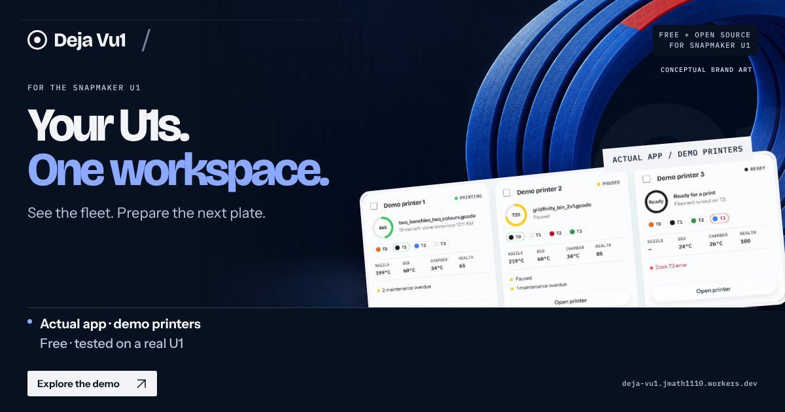
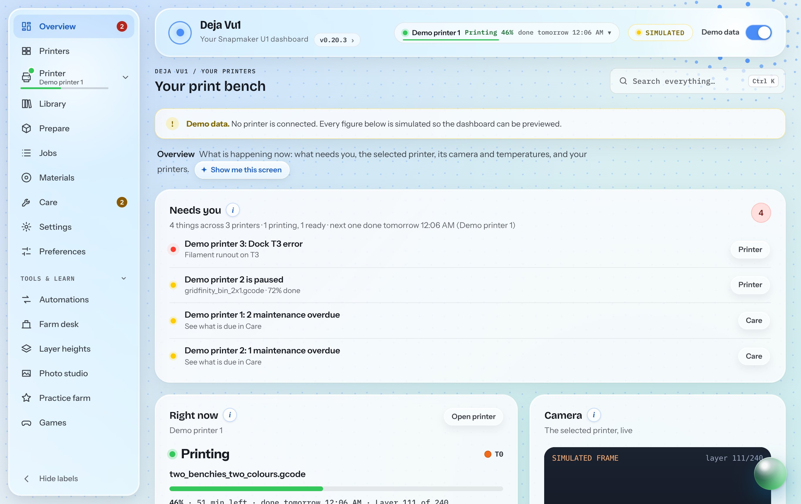
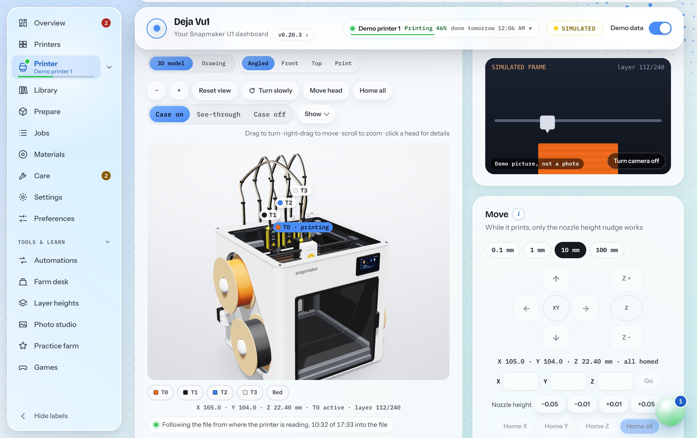
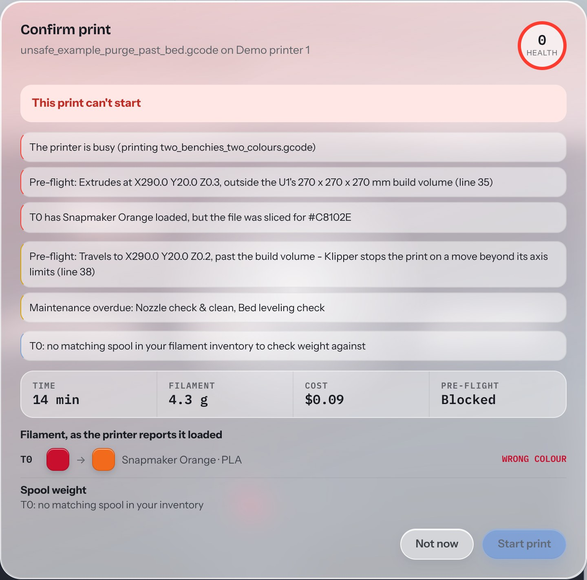
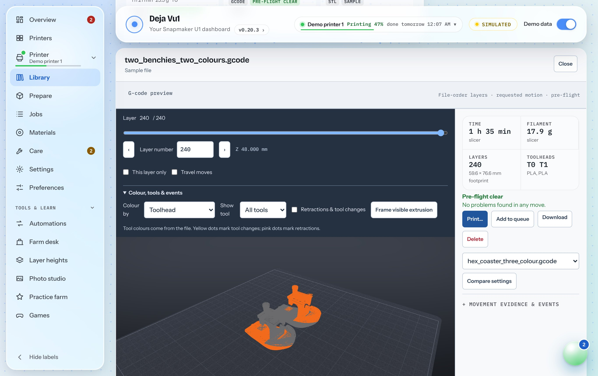
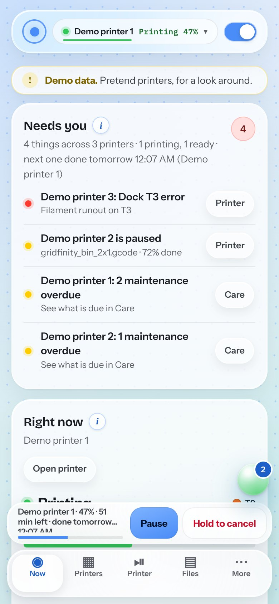

# Deja Vu1

A free dashboard for Snapmaker U1 3D printers. See every U1 on one screen, check a print before
it starts, slice and inspect plates, and keep each printer maintained. It runs on your own
computer, and you open it in a browser tab, in its own window or on your phone. No account, no
cloud.

**[Try the online demo](https://deja-vu1.jmath1110.workers.dev/?demo)** ·
[Install](#install) · [What has been tested](docs/testing.md) ·
[Getting started](docs/getting-started.md) · [Changelog](CHANGELOG.md)



<sub>App cards from the built-in demo printers. The blue loop is AI-generated brand art, not
hardware or a print. Deja Vu1 is an independent project, not made or endorsed by Snapmaker.</sub>

**Tested on a real Snapmaker U1** with stock firmware: live readings and the 3D twin, prints
started through Confirm Print, pause and cancel, the camera and time-lapses, and the Printer page
controls. Snapmaker sponsored the printer through its Innovation Fund. Every merge publishes a
new version on the [releases page](https://github.com/Jbyjre/Deja_VU1/releases/latest), and the
app updates itself from there.



<sub>The Overview with the built-in demo printers. **Needs you** puts a dock error, a paused print
and overdue maintenance at the top.</sub>

## What you can do

- **See every printer at once.** State, progress and finish time, the filament in each of the four
  heads, temperatures and a health score, for up to 12 printers. **Needs you** ranks what wants a
  person: a fault, a paused or finished print, maintenance that's due.
- **Ask an assistant, with your own AI.** Connect a Claude or ChatGPT plan, a model on your computer,
  or an API key from any of 30 services, and switch between them. Ask in your own words and watch
  the twin: it reads the printer, files and history, homes, moves and heats by itself, makes simple
  parts, suggests print settings, and asks only before it ends a print early. Fixed limits hold
  whatever it is told, only your tap starts a print, and a key rests in your computer's keyring.
  [AI assistant](docs/ai-assistant.md)
- **Check a print before it starts.** Confirm Print reads the file and the printer together: the
  build volume, toolheads and temperatures (with line numbers), the colour loaded in each head,
  nozzles, spool weight, maintenance, time, grams and cost. The server checks again when you press
  Start, even from your phone, and refuses in words if something changed.
- **Watch a live 3D twin.** A model of the U1 follows the print: the head on the gantry, the bed
  dropping as layers build, the spools in their colours, and the print itself, drawn from the
  file's own G-code. One click turns it into an engineering drawing with dimensions.
- **Prepare and slice.** Arrange STL, OBJ and 3MF models, assign heads T0 to T3, slice with
  Snapmaker Orca or OrcaSlicer (you install the engine) and inspect the G-code layer by layer.
  Projects from Bambu Studio, PrusaSlicer, OrcaSlicer and its forks, MakerWorld and Printables
  convert to the U1, with any number of colours fitted to its four heads.
- **Run the printer from your desk.** Move, heat, extrude and tune; fans, lights, the bed mesh,
  macros and the console, on one page per printer. Skip one failed object and let the rest finish.
- **Keep up with care.** Seven maintenance tasks counted by print hours, print counts and the
  calendar, a logbook of problems and fixes, a filament inventory with Spoolman import, and a print
  queue that waits until you confirm the bed is clear.
- **Check from your phone.** Scan the code on the Overview to open Deja Vu1 on your phone. Away
  from home, Settings → Away from home shares it on your private Tailscale network.
- **Automate the rest.** Rules send ntfy, Discord or Telegram notifications, set a WLED strip or
  Home Assistant (28 sensors), or pause a print.

<table>
<tr>
<td width="50%" valign="top"><br><sub><b>The Printer page:</b> the live 3D twin, the camera and the controls.</sub></td>
<td width="50%" valign="top"><br><sub><b>Confirm Print, refusing:</b> every reason in words, and Start stays off.</sub></td>
</tr>
<tr>
<td width="50%" valign="top"><br><sub><b>Inspect the G-code:</b> layers, heads and the pre-flight result before you print.</sub></td>
<td width="50%" valign="top"><br><sub><b>On a phone:</b> what needs you first, with Pause in reach of your thumb.</sub></td>
</tr>
</table>

<sub>Pictures from the built-in demo printers, in the default look.</sub>

## Try it without installing

The [online demo](https://deja-vu1.jmath1110.workers.dev/?demo) runs in your browser and plays a
recording of three simulated printers; halfway through, a filament jam reaches Needs you. It
never connects to a printer. The [product page](https://deja-vu1.jmath1110.workers.dev) has the
75-second film.

## Install

Deja Vu1 needs Python 3.8 or newer. Copy the block for your computer, paste it and press Enter. It
downloads the newest release into your Documents folder and starts it in under a minute. Run the
same block again any time to repair the app; your settings and files stay put.

### Windows: paste into PowerShell

1. Open **PowerShell**: press the Windows key, type `PowerShell`, press Enter.
2. **No Python yet?** Paste this line first, wait for it to finish, then close PowerShell and open
   it again:

   ```powershell
   winget install -e --id Python.Python.3.12
   ```

3. Paste this block and press Enter:

   ```powershell
   $ProgressPreference = 'SilentlyContinue'
   $dest = Join-Path ([Environment]::GetFolderPath('MyDocuments')) 'Deja_VU1'
   Invoke-WebRequest 'https://github.com/Jbyjre/Deja_VU1/releases/latest/download/deja-vu1-update.zip' -OutFile "$env:TEMP\dejavu1.zip"
   Expand-Archive "$env:TEMP\dejavu1.zip" -DestinationPath $dest -Force
   Set-Location $dest
   if (Get-Command py -ErrorAction SilentlyContinue) { py -3 start.py --background --autostart } else { python start.py --background --autostart }
   ```

You can close PowerShell afterwards: Deja Vu1 keeps running and starts by itself when you sign in
(**Settings → Desktop app** turns that off).

### Mac or Linux: paste into Terminal

Open **Terminal** (Cmd + Space, type `Terminal`, press Enter), paste this block and press Enter:

```bash
curl -fL -o /tmp/dejavu1.zip https://github.com/Jbyjre/Deja_VU1/releases/latest/download/deja-vu1-update.zip
python3 -m zipfile -e /tmp/dejavu1.zip ~/Documents/Deja_VU1 && chmod +x ~/Documents/Deja_VU1/*.command ~/Documents/Deja_VU1/*.sh
cd ~/Documents/Deja_VU1 && python3 start.py --background --autostart

```

If your Mac asks to install the command line developer tools, click **Install**, wait, then paste
the block again. The same block works on Linux and a Raspberry Pi.

### No code

Download **deja-vu1-update.zip** from the
[newest release](https://github.com/Jbyjre/Deja_VU1/releases/latest), extract it into Documents
and double-click `start-windows.bat` or `start-mac.command`. Or clone
`https://github.com/Jbyjre/Deja_VU1` with GitHub Desktop. Either way you need Python from
[python.org](https://www.python.org/downloads/) first (on Windows, tick **Add python.exe to
PATH**). [Getting started](docs/getting-started.md) walks through every step.

### Connect your printer

**Printers → Add a printer → Find printers on my network**, or type the printer's IP address and
press **Test**. Nothing gets installed on the printer: Deja Vu1 talks to Moonraker, the service
every U1 already runs. Turn on **Settings → Watch-only mode** first if you want to look around
before Deja Vu1 can send the printer anything. [Connecting a real printer](docs/real-printer.md)

<a id="update"></a>

<details>
<summary><b>Update in one paste</b></summary>

Updates install from **Settings → Version & updates**, and it's safe while a print runs: the
printer keeps the file and prints it by itself, and Deja Vu1 sends it nothing until it's back. Your
data stays where it is, a safety copy comes first, and the old version returns if the new one
fails to start.

To update from a terminal instead, open a **new** PowerShell or Terminal window and paste the block
for your computer. If you installed Deja Vu1 somewhere other than Documents, change the
`Deja_VU1` folder in the block. On version 0.8.0, use this block once: that version's Install
button can't install.

Windows:

```powershell
$ProgressPreference = 'SilentlyContinue'
$dest = Join-Path ([Environment]::GetFolderPath('MyDocuments')) 'Deja_VU1'
try { Invoke-RestMethod -Method Post 'http://localhost:8000/api/app/stop' -Body '{"for_update":true}' -ContentType 'application/json' -TimeoutSec 5 | Out-Null; Start-Sleep 2 } catch {}
Get-CimInstance Win32_Process -Filter "Name LIKE 'python%'" | Where-Object { $_.CommandLine -like '*Deja_VU1*app.py*' } | ForEach-Object { $p = Get-CimInstance Win32_Process -Filter "ProcessId=$($_.ParentProcessId)"; if ($p.CommandLine -like '*start.py*') { Stop-Process -Id $p.ProcessId -Force -ErrorAction SilentlyContinue }; Stop-Process -Id $_.ProcessId -Force -ErrorAction SilentlyContinue }
Invoke-WebRequest 'https://github.com/Jbyjre/Deja_VU1/releases/latest/download/deja-vu1-update.zip' -OutFile "$env:TEMP\dejavu1.zip"
Expand-Archive "$env:TEMP\dejavu1.zip" -DestinationPath $dest -Force
Set-Location $dest
if (Get-Command py -ErrorAction SilentlyContinue) { py -3 start.py --background } else { python start.py --background }
```

Mac and Linux:

```bash
curl -s -o /dev/null -X POST -H 'Content-Type: application/json' -d '{"for_update":true}' http://localhost:8000/api/app/stop; sleep 2; pkill -f 'Deja_VU1/backend/app.py'
curl -fL -o /tmp/dejavu1.zip https://github.com/Jbyjre/Deja_VU1/releases/latest/download/deja-vu1-update.zip
python3 -m zipfile -e /tmp/dejavu1.zip ~/Documents/Deja_VU1 && chmod +x ~/Documents/Deja_VU1/*.command ~/Documents/Deja_VU1/*.sh
cd ~/Documents/Deja_VU1 && python3 start.py --background
```

</details>

<details>
<summary><b>If Deja Vu1 won't open</b></summary>

Paste one block into a new PowerShell or Terminal window. It starts Deja Vu1 if it isn't running,
then checks the address, the page, the program, its files, demo data, every printer you added,
saved data and updates, and names anything that's wrong with the next block to paste. The offline
page tries to reconnect by itself first and offers a **Start Deja Vu1** button.

Windows:

```powershell
$dest = Join-Path ([Environment]::GetFolderPath('MyDocuments')) 'Deja_VU1'
if (-not (Test-Path "$dest\start.py")) { $ProgressPreference = 'SilentlyContinue'; Invoke-WebRequest 'https://github.com/Jbyjre/Deja_VU1/releases/latest/download/deja-vu1-update.zip' -OutFile "$env:TEMP\dejavu1.zip"; Expand-Archive "$env:TEMP\dejavu1.zip" -DestinationPath $dest -Force }
Set-Location $dest
if (Get-Command py -ErrorAction SilentlyContinue) { py -3 start.py --background --autostart } elseif (Get-Command python -ErrorAction SilentlyContinue) { python start.py --background --autostart } else { Write-Host 'Deja Vu1 needs Python 3.8 or newer: https://www.python.org/downloads/' }
```

Mac and Linux:

```bash
[ -f ~/Documents/Deja_VU1/start.py ] || { curl -fL -o /tmp/dejavu1.zip https://github.com/Jbyjre/Deja_VU1/releases/latest/download/deja-vu1-update.zip && python3 -m zipfile -e /tmp/dejavu1.zip ~/Documents/Deja_VU1 && chmod +x ~/Documents/Deja_VU1/*.command ~/Documents/Deja_VU1/*.sh; }
cd ~/Documents/Deja_VU1 && python3 start.py --background --autostart
```

</details>

## Safe by design

- **No invented numbers.** With no printer connected and demo data off, the server answers
  `{"connected": false, "demo": false}` and every panel shows an empty state. Demo data is
  labelled on every panel, and it never reaches a real printer.
- **Honest controls.** A command the printer refuses shows as refused, in words.
- **An assistant on a short lead.** The AI asks for named steps and Deja Vu1 checks each one: heater
  limits, the printer's own size, no moves before homing, the nozzle kept 2 mm off the bed. It can
  open Confirm Print and cannot press Start.
- **Watch-only mode** makes the server refuse every command to a real printer. Reads, the camera
  and the emergency stop still go through.
- **Your network only.** There's no login, so keep Deja Vu1 on a network you trust. It answers
  only to local addresses (which stops DNS rebinding), refuses commands sent by other websites and
  can't be framed. An optional device lock lets in only paired devices. Away from home, use
  Tailscale or a Cloudflare Tunnel behind Cloudflare Access. [Security](SECURITY.md) ·
  [Remote access](docs/remote-access.md)
- **Your data stays on your computer**, in `backend/data/`, as plain JSON and files. Updates never
  touch it.

## What has been tested

- **On a real U1** with stock firmware: connecting, live readings and the 3D twin, prints through
  Confirm Print, pause and cancel, the camera and time-lapses, and the Printer page controls.
- **Automated:** 1359 tests passed in 810 seconds on Python 3.13 (11 November 2026). GitHub Actions
  runs them on Python 3.8, 3.10, 3.12 and 3.13, and again before every release.
- **Slicing engines run for real:** Snapmaker_Orca 02.08.01.55 and OrcaSlicer 2.4.2 on Linux.
  Other builds show "Not tested" in the app and still slice.
- **Not tried yet:** macOS, a second printer, the Extended Firmware, and outside services such as
  Spoolman, WLED and Home Assistant.

The dated record, with what isn't built yet: [docs/testing.md](docs/testing.md).

## Coming next: Deja Vu1 Sense

Four heads mean four chances to load the wrong spool. Confirm Print already compares the colour
each head was sliced for with the colour the printer reports, and refuses a known mismatch. The
next step is a colour sensor for spools the printer can't identify: a sensor in a dark housing
reads the filament, and a Raspberry Pi Pico W sends the reading to Deja Vu1. Two candidate sensors,
the AS7341 and the TCS34725, get a bench test on real spools before anything goes near the printer.
A sensor mismatch starts as a warning you can accept. Spool scales come after it.
The [companion API](docs/colour-sensor-api.md) now receives identified sensor readings and expires
old samples. Firmware, guided calibration and optical advice in Confirm Print are still to build.
[The design](docs/hardware-modules.md)

## How it's built

- Python's standard library and nothing else: no packages to install. A hand-written WebSocket
  carries live state to every open page.
- Plain HTML, CSS and JavaScript: no framework, no build step. The 3D views use WebGL directly.
  The fonts ship with the app; nothing loads from a CDN, and there are no analytics.
- Deja Vu1 is its own code under the MIT licence. It talks to Moonraker and Klipper through their
  public API and slices with an engine you install. Facts about file formats and the U1 come from
  reading those projects' source; no code is copied. [CREDITS.md](CREDITS.md) lists each project
  and its licence.
- Deja Vu1 is written with the help of an AI coding assistant,
  [Claude Code](https://claude.com/claude-code), and every change is in the public history.


## Documentation

| For | Read |
|---|---|
| Installing and first steps | [Getting started](docs/getting-started.md) |
| Adding a real printer, and what each message means | [Connecting a real printer](docs/real-printer.md) |
| Trying Deja Vu1 on your own U1 | [Try it on your U1](docs/first-connection.md), [what to check](docs/beta-testing.md) |
| What ran where, with dates | [What has been tested](docs/testing.md) |
| Slicing, plates and engines | [Slicing and models](docs/slicing-and-models.md), [engine support](docs/engine-support.md) |
| Reaching it away from home | [Remote access](docs/remote-access.md), [low-latency camera](docs/low-latency-camera.md), [AR preview](docs/ar-preview.md) |
| The AI assistant: connecting, limits, what was tested | [AI assistant](docs/ai-assistant.md) |
| Keeping a copy of your data | [Backup and recovery](docs/backup-and-recovery.md) |
| The hardware modules | [Hardware modules](docs/hardware-modules.md) |
| How the code fits together | [Architecture](docs/architecture.md), [releasing](docs/releasing.md) |
| Every version | [CHANGELOG.md](CHANGELOG.md) |

## For developers

```bash
git clone https://github.com/Jbyjre/Deja_VU1.git
cd Deja_VU1
python3 start.py          # opens http://localhost:8000
```

Run the tests with `python3 -m unittest discover tests` (about 11 to 15 minutes; they use simulated
printers and a temporary data folder). Every change also shows in the online demo, which is the
same `frontend/` folder playing back a recording: a new or changed route needs
`python3 tools/online-demo/record.py`. Every merge to `main` publishes a release, and the pull
request title becomes its note. [CONTRIBUTING.md](CONTRIBUTING.md) has the house rules;
[CLAUDE.md](CLAUDE.md) and `.claude/rules/` are the working notes for AI coding sessions.

Settings for one start, as environment variables: `PORT` (default 8000), `DEJAVU_DATA_DIR`
(default `backend/data/`), `DEJAVU_ALLOWED_HOSTS` (extra host names, such as a tunnel's domain),
`DEJAVU_WATCH_ONLY=1`, `DEJAVU_MOONRAKER_LOG=1` (print every exchange with a printer),
`DEJAVU_SLICER_PATH`, `DEJAVU_WINDOW=browser|window|none` and `DEJAVU_NO_BROWSER=1`.

## License

MIT. See [LICENSE](LICENSE).
