# Deja Vu1

**One screen for every U1 you run.** See which printer needs attention,
prepare a plate, inspect its layers, and review the checks before you start.
Deja Vu1 is a free, open-source workspace for Snapmaker U1 printers. It runs on
your own computer, and you open it in a browser tab, in its own app window or on
your phone. You need no app account. The core needs Python; slicing needs a
separately installed compatible engine.


<sub>Actual app cards, simulated farm. The blue loop is AI-generated conceptual brand art, not hardware or a print result. Independent project; not affiliated with or endorsed by Snapmaker.</sub>

**Current version: 0.8.0** ([what's new](#whats-new-in-080) · [every version](CHANGELOG.md)).
The app shows the same number in its header and in **Settings → Version & updates**.

> **Looking for U1 owners.** Deja Vu1 has never talked to a real U1. If you own
> one and can spare 30 to 45 minutes, help run its first real connection. It's
> watch-only: you watch a print you're already running, and nothing is started
> or paused from Deja Vu1. **[How it works, and how to sign up](docs/first-connection.md)**

## Ways to use it

| You want to | Use | You need |
|---|---|---|
| Look around before installing | The [online demo](https://deja-vu1.jmath1110.workers.dev/?demo), in any browser | Nothing. It plays a recording of three simulated printers |
| Run your printers from your computer | A browser tab at `http://localhost:8000` | Windows, Mac, Linux or a Raspberry Pi, with Python 3.8 or newer |
| Keep it out of the browser | The **desktop app**: its own window, with an icon in the Start menu or Dock | Chrome or Edge on that computer ([how](#the-desktop-app)) |
| Check prints from the sofa | Your **phone**, on the same home Wi-Fi | The computer's address, which the launcher window prints |
| Check prints away from home | Your phone through **Tailscale** or a **Cloudflare tunnel** | A private connection you set up ([guide](docs/remote-access.md)) |

Every way except the online demo opens the same dashboard, served by the same
computer. Pause a print on your phone and the computer's screen shows it paused.

## How it all connects

```text
  Browser tab       Desktop app       Phone at home      Phone away from home
  on the computer   window            (home Wi-Fi)       (Tailscale or tunnel)
        │                │                  │                     │
        └────────────────┴────────┬─────────┴─────────────────────┘
                                  │
                ┌─────────────────┴─────────────────┐
                │  Your computer, running Deja Vu1  │
                │  the launcher window keeps it on; │
                │  settings and files live here     │
                └─────────────────┬─────────────────┘
                                  │  home network
                ┌─────────────────┼─────────────────┐
           U1 printer        U1 printer        … up to 12

  The online demo is separate: a recording that runs inside your browser.
  It never connects to a printer or to your computer.
```

- **The launcher** is the file you double-click: `start-windows.bat`,
  `start-mac.command` or `start-linux.sh`. It starts Deja Vu1 and keeps it
  running. Close its window and the dashboard stops.
- **The dashboard** is what you see. Any screen on your home network can open it.
- **Your data** stays in one folder on that computer, `backend/data/`. Updates never touch it.
- **Your printers** need nothing installed. Deja Vu1 talks to Moonraker, the web
  service already running on every U1.

### Watch the 60-second launch film

[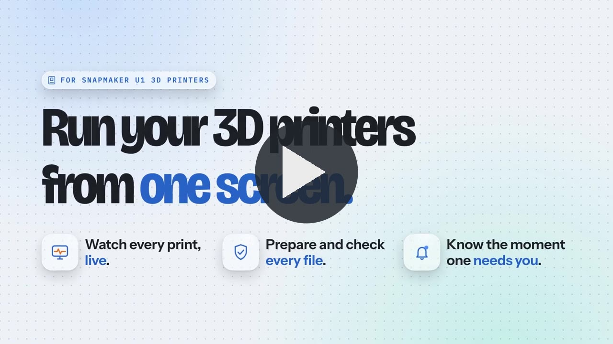](https://deja-vu1.jmath1110.workers.dev/#film)

<sub>Click the picture to watch it on the product page, or
[download the full-quality MP4](marketing-library/07-videos/deja-vu1-launch-v1-60s-16x9.mp4)
(49 MB). Filmed on the simulated farm; the vertical 9:16 cut and the other
versions are in [`marketing-library/07-videos/`](marketing-library/07-videos/).</sub>

## Install

You need **Python 3.8 or newer** ([python.org](https://www.python.org/downloads/)).
On Windows, tick **Add python.exe to PATH** in the installer.

Then pick how you get the files. Both update from inside the app.

| | GitHub Desktop or git | A ZIP download |
|---|---|---|
| Get it | GitHub Desktop: **File → Clone repository → URL**, paste `https://github.com/Jbyjre/Deja_VU1`, **Clone**. Or in a terminal: `git clone https://github.com/Jbyjre/Deja_VU1.git` | The [newest release](https://github.com/Jbyjre/Deja_VU1/releases/latest) → **Source code (zip)**, or **Code → Download ZIP** on this page. Extract it into your Documents folder |
| Updates follow | Every change merged into `main` | Each published release |
| Best for | Getting fixes the day they land | Fewer, tested steps |

**Start it:** double-click `start-windows.bat` (Windows), `start-mac.command`
(Mac) or `start-linux.sh` (Linux). If macOS says it can't check the file, open
**System Settings → Privacy & Security** and choose **Open Anyway**. Or open a
terminal in the folder and run `python3 start.py`.

Your browser opens the dashboard and setup begins. Setup lets you pick a look,
connect your printer, take a tour of every screen, set up your phone and the
desktop app, and turn on automatic update checks. Step-by-step help, with
firewall and phone details: [getting started](docs/getting-started.md).

### The desktop app

You don't have to use a browser tab. **Settings → Desktop app** offers two ways out:

- **Install Deja Vu1 as an app.** Chrome and Edge install it with its own window
  and an icon in the Start menu or Dock. Press **Install Deja Vu1**, or use the
  install icon at the right of the address bar.
- **Open as a window when the launcher starts.** The launcher opens Deja Vu1 in a
  window with no tabs or address bar, using Edge (included with Windows) or Chrome.

Both show the same dashboard. The launcher window still runs it, so keep that open.

## Update

Open **Settings → Version & updates** and press **Check for updates**, then
**Install**. Or turn on **Look for updates by itself**: the app checks at
startup and once a day, and the glass orb in the bottom-right corner tells you
when a new version is ready.

| Your copy | What Install does |
|---|---|
| Made with GitHub Desktop or git | Pulls the newest version of `main` from GitHub, as a fast-forward only. If you changed any of its files by hand, it stops and changes nothing |
| Downloaded as a ZIP | Downloads the newest release, checks its SHA-256 fingerprint, replaces the app files and restarts |

Both keep your settings and files, restart the dashboard, and put the previous
version back if the new one fails to start. Two conditions: start Deja Vu1 with
the launcher, and wait until your printers are idle.

### Coming from an older copy

If your Settings has no **Version & updates** card, your copy predates the
updater that handles it. Update it by hand, once:

- **GitHub Desktop:** open it, choose the **Deja_VU1** repository, press **Fetch
  origin**, then **Pull origin**. Close the launcher window and start it again.
- **git:** run `git pull` in the folder, then restart the launcher.
- **ZIP:** download the new version into a new folder. Copy the old folder's
  `backend/data` into the new one, then start the new one. Keep the old folder
  until the new one works.

From then on, updates come through the app. A downloaded copy that shows an
older **App updates** section can also try **Check for updates** there.

## What's new in 0.8.0

- **Updates that find you.** Releases now publish on GitHub by themselves, and
  copies made with git or GitHub Desktop update from inside the app too.
- **A version you can see.** The header shows the version. **Settings → Version
  & updates** lists every version's changes, each with a full-screen tour.
- **A notification orb.** Messages rise out of a glass orb in the bottom-right
  corner and sink back in. Click it for the last 30.
- **A window of its own.** Install Deja Vu1 as an app, or let the launcher open
  it in an app window.
- **A tour of every screen.** Setup's tour now covers every screen in 54 stops,
  with things to try. It also explains that Workshop, Studio and Garage are
  three pretend demo printers, and that Photo studio is a separate tool.

**Also in 0.8.0:**

- **The print itself, in its real colours, inside the 3D twin:** the twin now reads the
  file being printed (downloaded from the printer, or from your file library) and grows the
  outside walls of every layer up to the one being printed, each in the colour loaded in the
  head that prints it; the rest of the print shows faintly above. A new **Print** view closes
  in on the plate. The demo's Workshop printer now prints two 3DBenchy boats in two colours,
  orange hull and black cabin and the reverse, swapping heads on every layer.
- **Take the case off:** the 3D model has a Case on / See-through / Case off switch. With the
  case off you see the frame, the CoreXY motors, belts and idlers and the Z lead screw (drawn
  where they must be, sizes estimated and labelled so), plus options for the print, what's
  left of it, head labels and a slow turntable.
- **A real engineering drawing sheet:** a zoned border, numbered balloons with leader lines
  and a parts list, notes, the plate's centre lines, the print's height so far against its
  full height, the print washed in its filament colours, and a full title block (drawing
  number, sheet, units, date, third-angle projection symbol).
- **A 3D viewer that looks like a slicer, not a grid:** a real 276 × 293 mm textured plate
  with a fine grid on it only, a soft studio backdrop, a contact shadow and proper lighting.
- **Mixed layer heights, rebuilt around what you want:** one question first (finest detail,
  balanced, fastest or one height), each answer previewing what it sets on every head; then
  each head in a plain sentence with Thinner and Thicker buttons. The expert controls wait
  under Fine-tune.
- **Updates from inside the app:** choose Newest builds and Deja Vu1 compares every file with
  GitHub, downloads only what changed, checks each file against GitHub's own record of it,
  and restarts into the new version (rolling back if it fails to start). Automatic checks
  every 15 minutes, and optional automatic install while every printer is idle.
- **It never forgets:** every record keeps its last good copy, a damaged file repairs itself,
  and safety copies of everything the dashboard remembers are made every 6 hours, at start-up
  and before every update, restorable from Settings (a restore can itself be undone).
- **Pick up where you left off:** Files finds Snapmaker Orca or OrcaSlicer on this computer,
  copies your recent projects in and turns your own presets into a slicing profile.
- **What your history says:** Overview reads the printer's own print history (a real U1 brings
  everything it has printed) into findings that only appear with enough prints behind them.
- **An optional device lock:** only paired devices can use the dashboard; this computer
  always can.
- **Check it yourself:** Settings → About runs nine real checks inside your own copy in a few
  seconds, and lists what Deja Vu1 builds on (see also [CREDITS.md](CREDITS.md)).
- **Smaller and fixed:** the games load only when you open them (they were two thirds of the
  dashboard script); Snapmaker Orca is found by itself for slicing; a printer that needs an API
  key says how to fix it; a heater fault shows on its own dock ring; and a printer stopped with
  an error can be recovered with Restart firmware.

**Since 0.8.0** (on `main`, in the next release):

- **A clearer first look:** current screenshots, art-directed share cards and shorter
  descriptions show the fleet, preparation workspace and print checks. Demo data,
  engine estimates and unverified hardware are labelled where they appear.

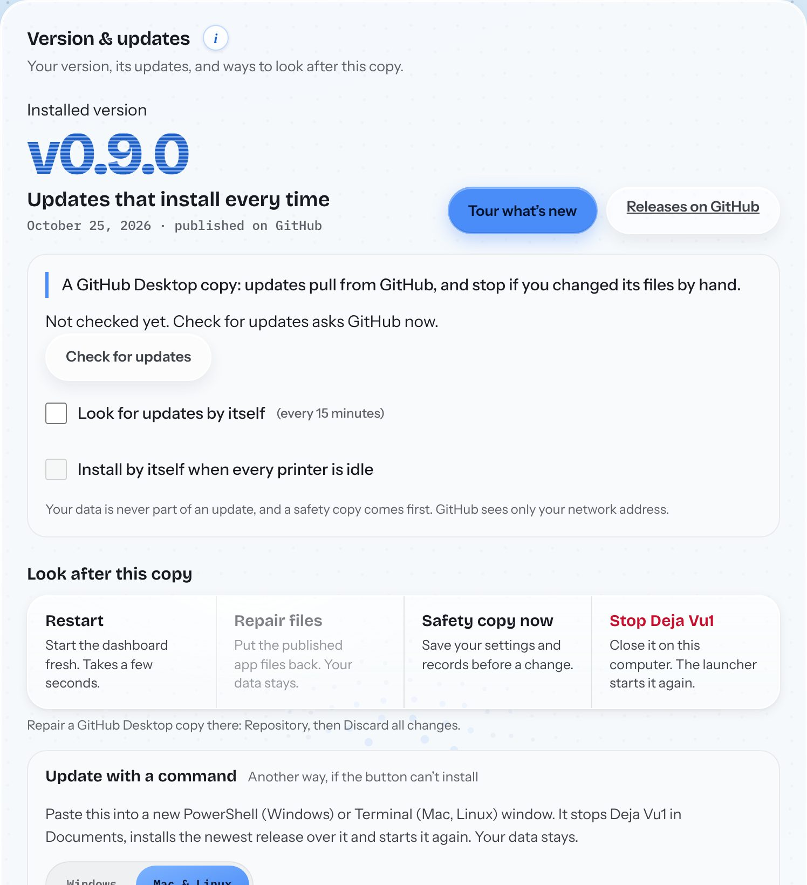 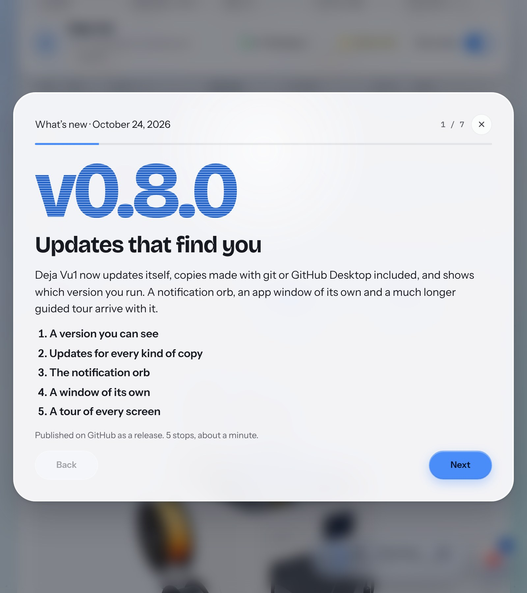

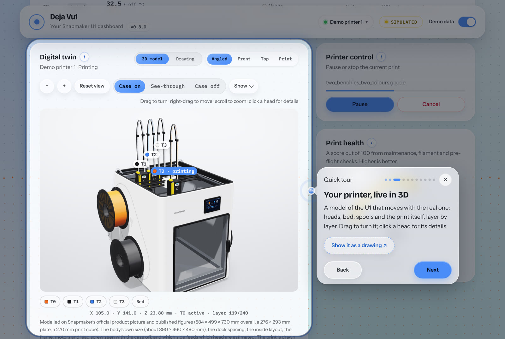 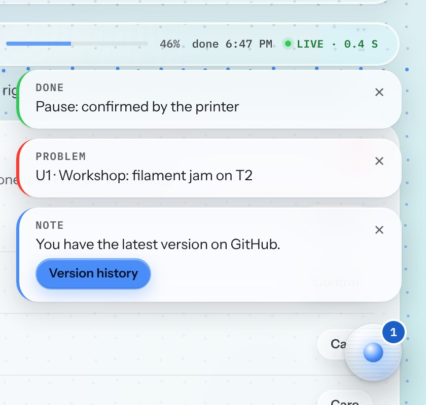

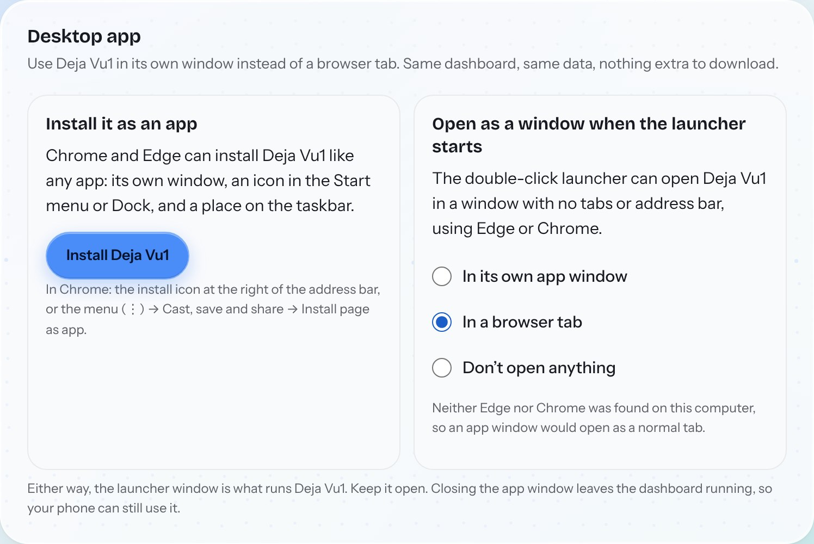

<sub>Captured from the simulated farm with Demo data on. The messages in the orb picture are examples sent for the picture.</sub>

### Earlier versions

Versions before 0.8.0 were rounds of work, numbered afterwards and never
published as downloads. Full detail: [CHANGELOG.md](CHANGELOG.md).

| Version | Date | What it added |
|---|---|---|
| 0.7.0 | 23 Oct 2026 | The real 3DBenchy samples, the Layer stack for mixed layer heights, 106 slicer settings, the Farm desk, telemetry, a logbook, search, and a clickable online demo |
| 0.6.0 | 23 Oct 2026 | A realistic 3D twin of the U1, a drawing made from it, and a livelier background with surprises |
| 0.5.0 | 22 Oct 2026 | The cursor-reactive background, rewritten games and a full-screen setup |
| 0.4.0 | 21 Oct 2026 | One slicing workspace, separate layer heights per head, and full backup and recovery |
| 0.3.0 | 20 Oct 2026 | The plate editor, a real OrcaSlicer slice, photo-to-print tiles, camera snapshots and the first updater |
| 0.2.0 | 14 Oct 2026 | The online demo, the mixed-nozzle planner, Find printers and skip one object |
| 0.1.0 | 4 Aug 2026 | The first dashboard: printer connection, fleet, controls, Photo-to-Print Studio and maintenance |

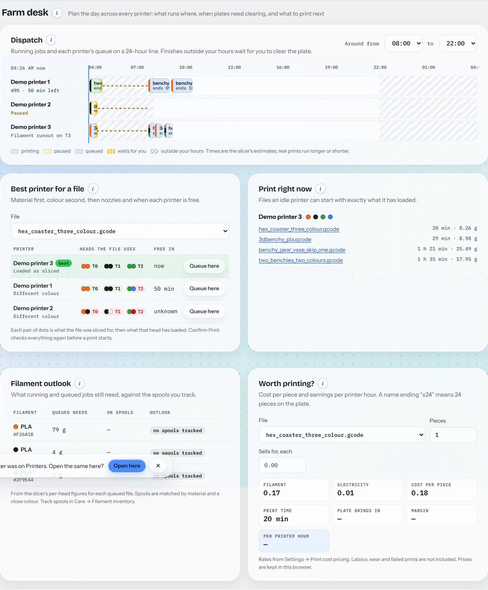

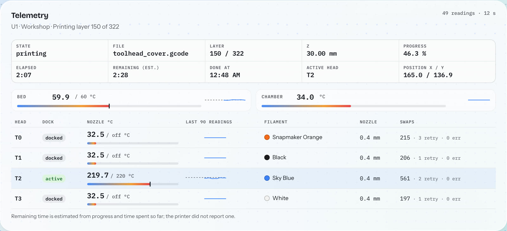 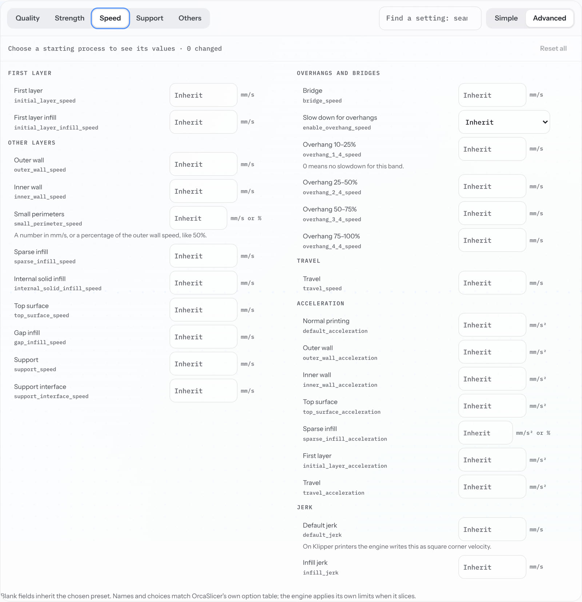

 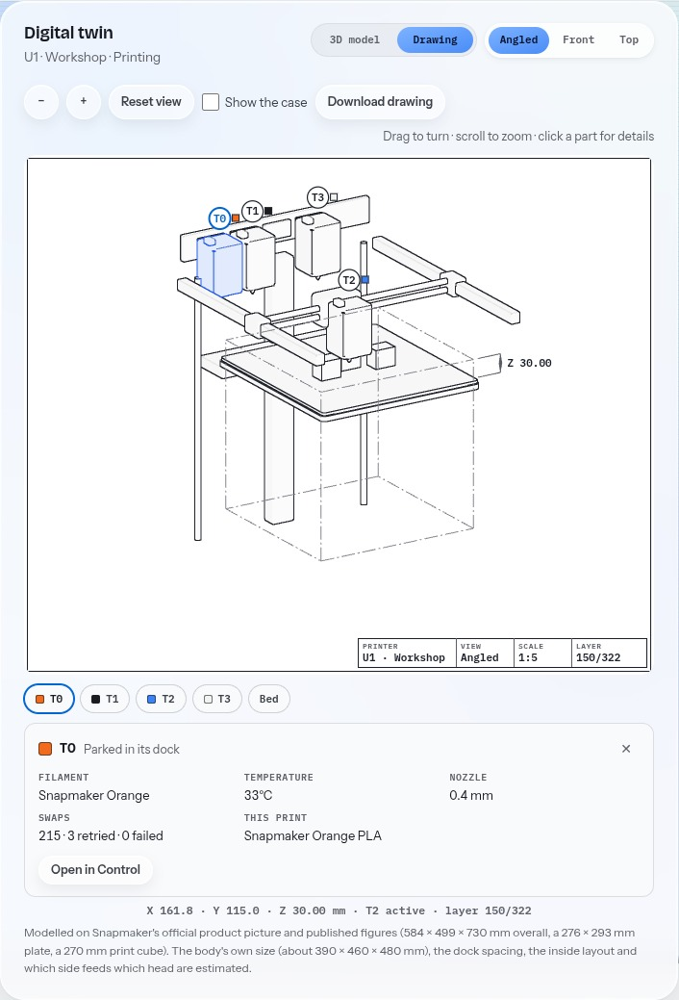

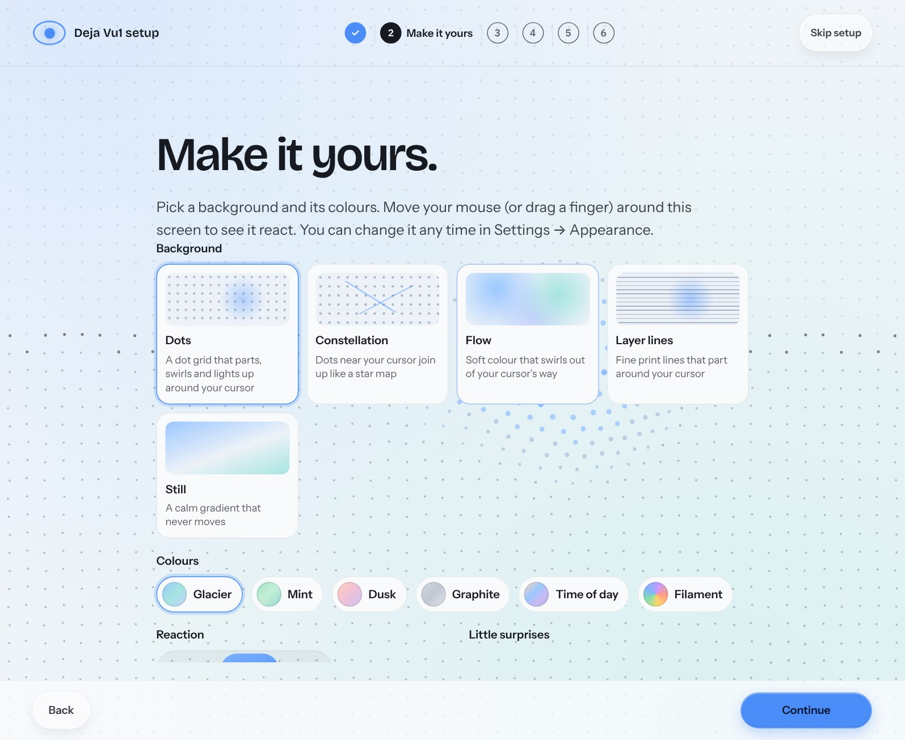 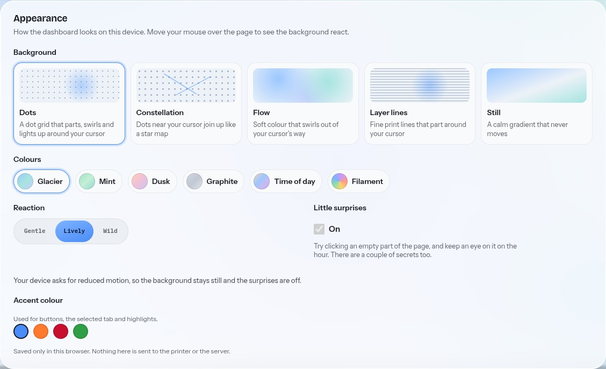

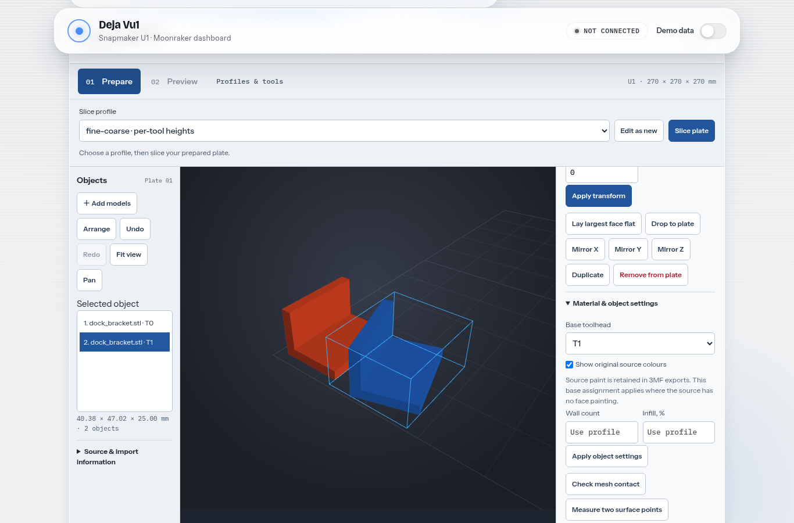

[Engine setup and format limits](docs/slicing-and-models.md) ·
[Validation, performance and screenshots](docs/slicer-workspace-validation.md) ·
[Change history](CHANGELOG.md)

**Quick links:** [ways to use it](#ways-to-use-it) · [install](#install) · [update](#update) ·
[getting started](docs/getting-started.md) · [what's in it](#whats-in-it) ·
[current status](#current-status) · [security](#security-and-your-network) ·
[first connection](docs/first-connection.md) · [for developers](#for-developers-and-ai-coding-sessions)

The dashboard supports up to 12 printers through Moonraker, the printer's web
API. Shared live state feeds controls, alerts, maintenance, filament tracking,
queues and the 3D twin. Optional integrations connect to ntfy, Discord,
Telegram, Home Assistant, WLED and Spoolman. A labelled simulated farm lets you
explore without a printer. [Current status](#current-status) says what was
tested and what still needs physical hardware.

Much of the code is written with [Claude Code](https://claude.com/claude-code),
and every change is in the public history.

## Why it exists

You walk over to the printer to answer the same four questions. Deja Vu1 brings
the printers’ reported state into one view, with unknown information left unknown.

**Is it still printing?** Shared live state updates the dashboard, and
**Needs you** ranks what wants a person across the whole farm: a jam, a paused
print, a finished plate, an idle printer with work waiting. Automations send
it to your phone.

**Will this file print on a U1?** The pre-flight check flags extrusion outside
the 270 × 270 × 270 mm build volume, unknown toolheads and unsafe
temperatures, with line numbers. MakerWorld, NexPrint and OrcaSlicer projects
can be converted where their settings and geometry are supported. Select one
plate for slicing; complete vendor paint and texture fidelity is still limited.

**Is the right filament loaded?** Four toolheads mean four chances to load the
wrong spool. Deja Vu1 compares the colour each toolhead was sliced for with
what the printer reports, and stops the start on a known mismatch. Missing
filament information stays unknown and asks you to check by eye.

**What needs checking before I start?** Confirm Print pulls it together: pre-flight,
filament match, nozzles, spool weight, maintenance, time, grams and cost. The server
checks again at the moment of starting and refuses in words if something
changed, even when you start from your phone. Checks help you review a job;
they do not guarantee a successful print.

## What's in it


Farm screenshots use **Demo data**. The current slice-preview capture contains
actual engine estimates, not physical measurements. Older feature crops predate
the current workspace; see [paired captures](docs/slicer-workspace-validation.md).

### Run the farm and check prints: no add-on hardware needed

| Feature | What it does |
|---|---|
| **Printer fleet** | **Find printers on my network** adds a U1 without typing an address (it asks the network, then tries Moonraker's port on your home network, and checks each one); **Test** checks a typed address first. Every printer at a glance: state, progress, the filament in each dock, temperatures, alerts, a health score. One tap points the whole dashboard (maintenance, control, cost, queue, everything) at any of them. |
| **Live updates** | The live loop targets 250 ms updates, subject to printer and network response, pushed to the browser over a WebSocket written from scratch in standard-library Python. If the WebSocket fails three times (a network that blocks it, or a server restart), the dashboard asks once a second instead, says so, and tries the WebSocket again every 30 seconds. |
| **Needs you** | The top of the Overview ranks every printer by what wants a person: a fault the printer reported, a paused or finished print, an idle printer with files waiting, overdue maintenance, a print finishing within 15 minutes, each with a button straight to the right tab. When nothing does, it says so, with how many are printing and when the next one finishes. |
| **Start a print from your phone** | Pick a file, read one Confirm Print summary (pre-flight check, filament match, spool weight, maintenance, time, grams and cost) and start it. The server re-checks at the moment of starting and **refuses** if something is wrong. |
| **Pre-flight risk check** | Flags extrusion outside the U1's 270 × 270 × 270 mm volume, the nozzle below the bed, unknown toolheads, unsafe temperatures, travel moves below plastic already printed, and more, with line numbers. A file still numbering a filament add-on's extra slots (multiACE's T4–T15) is told to run that add-on's post-processor first; its rewritten file passes. |
| **Mixed-nozzle planner** | Calculates a common grid and checks preferred heights against U1 nozzle limits. It does not slice. The workspace separately sends validated preferences to a capable engine; Confirm Print checks fitted nozzles. |
| **MakerWorld / NexPrint / OrcaSlicer → U1** | Converts supported projects for the U1 while retaining source settings and colours. Multi-plate layouts use the U1 grid; select and separate one plate for local slicing. Failures include a reason and copyable report. Complete vendor extension/texture fidelity is not guaranteed. |
| **Skip one object** | When one part on a full plate fails, skip just that one and let the rest finish (Klipper's `exclude_object`, which Snapmaker's U1 profiles switch on). The Control tab draws the plate from above like a drawing sheet: each part outlined with a numbered balloon that matches the list, the one printing now in blue, skipped ones section-hatched, the bed dimensioned. Pick one, confirm, and only that one stops. |
| **Print queue** | Files to print one after another. Each one passes the same Confirm Print check before it starts; anything that doesn't pass waits, with the reason. |
| **Automations** | Local rules: a temperature crosses a line, a print starts / pauses / finishes / fails, the wrong filament is loaded, maintenance is overdue → send a notification, set a WLED light, set a Home Assistant sensor, or pause the print. Every firing is logged with what really happened. |
| **Digital twin** | Two ways to see each printer, live, both from one detailed model of the U1 (from Snapmaker's official product picture and published figures; the body's own size and inside layout estimated). **3D model:** studio-lit and realistic, with the head on the gantry, the bed dropping as Z rises, idle heads in the rear docks, the spools in their loaded colours, the touchscreen showing the printer's state and the print growing on the bed; drag to turn, right-drag to move, scroll or +/− to zoom. **Engineering drawing:** made from the same geometry and drawn the drafting way: one ink, hidden edges dashed, the build volume as a phantom line, real dimensions and a title block with its scale. The bed drops as each layer is added, the toolhead and gantry move, the parts on the plate come from the file's own object outlines (a skipped one is crossed out), and the four rear docks carry balloons with each head's filament. **Click a toolhead** for its temperature, filament, nozzle size, lifetime swaps, retries and failures (from the U1's firmware) and what the running print needs from it; click a part for its size and a shortcut to skip it; click the bed for its temperature and height. Angled, front and top views in both modes; the drawing can show the case with its estimated size and downloads as a PNG picture (an SVG line drawing is used where WebGL 2 isn't available). |
| **File library** | G-code, 3MF, STL and triangular OBJ files, with available thumbnails, estimates, pre-flight results and recent files. Missing time or filament metadata stays unknown. |
| **Prepare and preview** | Edit multi-object STL/OBJ/3MF plates, save a new source-preserving 3MF, slice through an installed engine and inspect its G-code by layer. Plain WebGL; no 3D library. Complex paint/textures remain limited. |
| **G-code viewer + small edits** | Read the file line by line, search it, change one number, comment a line out or insert one command, each edit validated first (no emergency-stop lines, no toolheads the U1 doesn't have), the original kept, the pre-flight re-run. |
| **Honest controls** | Every button says what it's sending straight away ("Pausing…"), then shows only what the printer actually reports back. A command the printer refuses is shown as refused, in words, never as done. |
| **Finish time on the clock** | Alongside "2 h 17 min left", every running print says when it will finish ("done 2:42 PM", "tomorrow 1:05 AM") on the status ribbon, the fleet cards and the live pill, from the same estimate. |
| **The browser tab follows the print** | The page title mirrors the selected printer, "53% · U1 · Workshop · Deja Vu1" (or Paused, Finished, Needs attention), and the tab's icon draws the progress ring, so a background tab still tells you how it's going. |
| **View on your desk (AR)** | Places an STL or 3MF model on your real desk at its real printed size, through the phone's camera. Works on Android/WebXR browsers; iOS Safari has no equivalent. The button only appears where AR is supported, and it needs an `https://` address, such as the Cloudflare Tunnel. See [docs/ar-preview.md](docs/ar-preview.md). |
| **Print health gauge, chamber climate, time-lapse flipbook, celebration card, "continue on another device", calibration reminder after a nozzle swap, weight-based filament forecast, side-by-side settings diff, 28 Home Assistant sensors, MJPEG camera relay** | The supporting cast, see [docs/architecture.md](docs/architecture.md). |

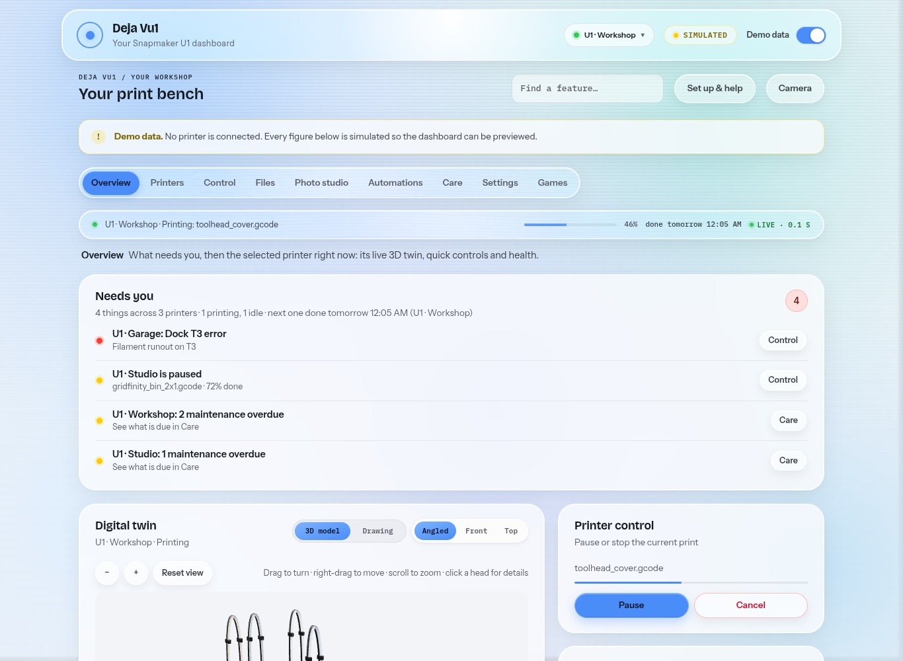

<sub>**Overview:** the status ribbon with progress and finish time, then **Needs you**, ranking everything that wants a person across all three printers.</sub>


<sub>**Printers** (the Fleet view): every printer's state, progress, filament per dock, temperatures and health, with controls to command several at once.</sub>


<table>
<tr>
<td width="50%" valign="top"><br><sub><b>Confirm Print, refusing:</b> the built-in unsafe example file, with every reason in words and the start button disabled.</sub></td>
<td width="50%" valign="top"><br><sub><b>A sliced plate:</b> inspect layers and toolpaths beside real-engine estimates, then open pre-flight and Confirm Print.</sub></td>
</tr>
</table>

<table>
<tr>
<td width="50%" valign="top"><br><sub><b>Files:</b> thumbnails and estimates, a pre-flight badge on every G-code file, and the print queue beside them.</sub></td>
<td width="50%" valign="top"><br><sub><b>Automations:</b> choose an event and action from a ready-made example; every firing is logged.</sub></td>
</tr>
</table>


<sub>**Digital twin, quick controls and print health:** a live 3D model of the printer (the bed dropping as layers build, the head moving, the parts on the plate, the four docks, the spools in their colours), Pause and Cancel, and one health score with every deduction listed. The engineering drawing is one click away.</sub>

<table>
<tr>
<td width="42%" valign="top"><br><sub><b>Click a toolhead:</b> its nozzle, swaps and what this print needs from it.</sub></td>
<td width="58%" valign="top"><br><sub><b>Layer stack:</b> one base layer, each head a whole multiple of it, with smart set-ups.</sub></td>
</tr>
</table>


<sub>**Add a printer:** test an address before adding it. This capture uses a local stand-in Moonraker, not a physical U1.</sub>


<sub>**Skip one object:** pick the failed part on the plate map, confirm, and the rest keep printing.</sub>


**Converting a supported project:** keep the original, review the conversion
report, then select a plate for slicing. All three plates of the recorded test
fixture passed the Linux engine separately. Complex vendor paint, textures and
per-part settings remain limited. Conversion is not proof of printability.

<br clear="right">

### Care, control and the basics: no add-on hardware needed

| Module | What it does |
|---|---|
| **Maintenance reminders** | Seven tasks. Six track cumulative hours, print counts or calendar time since they were last done (nozzle, bed, belts, rails, dock alignment, fans); the seventh, recalibration, comes due when you record a nozzle or hotend swap. Each resets when you mark it complete. For a real printer, counting starts from its totals on first connection. |
| **Printer control** | Pause, resume, cancel, set a toolhead's target temperature, home an axis, or send a raw G-code line, with a live console log. |
| **Push notifications** | Alerts via ntfy.sh, Discord, or Telegram using HTTP requests, with no app SDK. Configure the chosen service's topic, webhook or bot credentials. They're sent by the rules you set in **Automations** (it offers ready-made ones such as "Tell me when a print finishes"). A rule marked urgent always sends; a normal one waits out your quiet hours instead of buzzing your phone at 3am. |
| **Update checker** | Reads Moonraker's own update-status API and flags when Klipper or Moonraker have an update waiting. |
| **App-data backup & recovery** | Versioned full app-data ZIP with checksums, omitted connection secrets and restore preview. Recovery creates a separate folder and launchers; it keeps existing data and disables automatic actions. Includes library, per-printer logs, fleet, queues, presets and time-lapse. Limits: 512 MB unpacked / 256 MB ZIP; files over 64 MB and external installations require an offline copy. |
| **Camera bridge** | Brings the printer's camera feed in, with a watchdog that flags a frozen stream instead of silently showing a stale image. |
| **Phone pairing** | A short one-time code, entered on a second browser, adds it to a paired-devices list, no account, no password, nothing that leaves your network. It's a convenience list, not a lock: see [security](#security-and-your-network). Always on. |
| **Print cost calculator** | Prices filament by material and adds electricity, for a print in progress and for recent history. $/kg per material, $/kWh and printer wattage are editable. |

<table>
<tr>
<td width="50%" valign="top"><br><sub><b>Care:</b> each maintenance task with how far it has run, overdue ones in red.</sub></td>
<td width="50%" valign="top"><br><sub><b>Control:</b> the running print, all four toolheads' temperatures, homing and a G-code console.</sub></td>
</tr>
</table>

### Running a farm, and making new things: no hardware needed

| Feature | What it does |
|---|---|
| **Fleet command center** | Tick several printers in the Printers tab and preheat, pause, resume, home or cancel them together. The commands go out in parallel through the same per-printer controls as everywhere else, and every printer's result is read back and listed separately ("Pause: 2 of 3 confirmed; failed on U1 · Garage", with each printer's reason, such as "Nothing is printing right now", in its own row), never a blanket "done". Drag a G-code file (or a waiting queue item) onto any printer to put it on that printer's queue. A farm history panel shows prints, completed vs. failed, and material per day or week, per printer and for the whole farm, summed from each printer's own history. |
| **Photo-to-Print Studio** | Make four-tool dithered tiles, measured-swatch layered models, calibration sheets and closed image-heightmap reliefs. The older absorption-based relief editor remains available. New generation sends a reduced pixel grid to the local app server; legacy relief calculation stays in the browser. Generated files enter the normal preparation/slicing workflow. Physical colour accuracy is unverified. |
| **Farm sandbox** | A simulated farm of up to 27 printers, with scripted scenarios (a jam mid-print, a runout, a heater fault, a network drop, the wrong filament loaded, maintenance going overdue) and a clock you can play, speed up, or step forward. Everything else in the dashboard (fleet, automations, queue, notifications, history) reacts, because the sandbox drives the same simulated printers they all read. Demo data only. |

<table>
<tr>
<td width="50%" valign="top"><br><sub><b>A bigger farm:</b> the three built-in printers plus six added in the sandbox. All readings are simulated.</sub></td>
<td width="50%" valign="top"><br><sub><b>Farm sandbox:</b> the "Jam mid-print" scenario on its clock, one-off events, and a log of what happened.</sub></td>
</tr>
</table>


<sub>**Photo-to-Print Studio:** the built-in test pattern turned into a layered relief. The right-hand preview is modelled, not photographed.</sub>


On a phone the layout is rebuilt thumb-first: the main sections and the
Pause / Hold-to-cancel / Start-next controls sit at the bottom of the
screen, with the print's progress on a line just above them on every tab.
Open the computer’s address on your phone over your home Wi-Fi.
**Settings → Pair another device** is optional bookkeeping; it is not a login.

**Add to Home Screen** gives it a proper icon and name, opening without the
browser's bars where the phone allows.

<br clear="right">

### Optional: on by request

| Module | What it does |
|---|---|
| **Filament inventory** | Tracks spools on hand, flags print files needing a colour you don't have, and nudges you if a spool has sat loaded for weeks. **Import from Spoolman** brings in the spools you already track in [Spoolman](https://github.com/Donkie/Spoolman), with their colour and grams left; importing again updates them instead of duplicating. |
| **What changed?** | Compares the job about to print against your last few runs of that file, and flags a likely cause when the file has failed before and shares a pattern (a filament type in common, say). |
| **Pre-print sanity check** | Combines maintenance, dock status, and colour-check into one "safe to print?" verdict. |
| **WLED bridge** | Pushes dock ring colours to a WLED-flashed LED strip you already own, over WLED's own JSON HTTP API, no extra hardware to build. |
| **Home Assistant bridge** | Publishes printer state as a handful of REST sensors, so it shows up on an existing HA dashboard, no MQTT broker, no custom component. |
| **Auto-print pipeline** | Slices STL and 3MF models with [OrcaSlicer](https://github.com/SoftFever/OrcaSlicer), **a separate program you install yourself**, using Orca presets you choose; the G-code lands in the file library, or straight on a printer's queue, where it still passes Confirm Print before it starts. Off by default. Driving another program from outside is fragile, an Orca update can change its command line, so every slice has a time limit, is checked for real printable layers before it's kept, fails in words with Orca's own message, and records the Orca version that made it. |
| **Low-latency camera (WebRTC)** | Plays the camera with almost no delay through [go2rtc](https://github.com/AlexxIT/go2rtc), **a separate program you install yourself**. It's one step beyond "nothing to install", so it's off by default. MJPEG stays the default, and the dashboard falls back to it automatically, saying which feed is on. See [docs/low-latency-camera.md](docs/low-latency-camera.md). |

### Interface + simulation, hardware pending

| Module | What it does |
|---|---|
| **Dock status rings** | Proposed rings beside the toolhead docks: soft white for ready, pulsing green with a progress arc for printing, pulsing amber for heating, blue for paused, blinking red for a fault. The on-screen logic is implemented; physical ring drivers and validation are unfinished. The separate WLED bridge can send the same state to a configured strip. |
| **"Right colour loaded?"** | Proposed optical check against the file’s expected colour. Comparison logic and simulation exist; sensor hardware, driver and calibration are unfinished. |


<sub>**Dock status rings, on screen today:** what each LED ring would show. The physical rings are waiting on hardware.</sub>


<sub>**Why dock status matters:** a parked toolhead looks the same whether it's ready, out of filament or faulted. Deja Vu1 shows each dock's state on screen today, and on the rings once they exist.</sub>


Every module can be switched on or off from **Settings → Modules**: the
toggle you see there is enforced by the server, not just hidden in the
interface. Disabled module routes refuse requests; background automation actions,
queue advancement, time-lapse capture and filament deduction also check their
module switches. "View on your desk" is browser-only; phone pairing is always on.

<br clear="right">

### While you wait (the Games tab)

Ten games, playable from the dashboard while a long print runs: **Sky
Dash**, **Pong**, **Minesweeper**, **Tetris**, **Pac-Man**, **Brick Break**,
**Blackjack**, **Asteroids**, **Snake** and **2048**. None of them read the
printer; the status strip and the live print pill stay visible on every
tab, including mid-game, so a finished or failed print is never missed.
Best scores are remembered per browser. Every game runs at the same speed on
any screen (60 Hz or 144 Hz), waits for you to start, pauses when you switch
tab or window, and sizes its playing field to fit the window. On a phone,
Pac-Man, Snake and Tetris show touch buttons and also take swipes.


## Why one dashboard, not several tools


Everything reads from the same Moonraker connection and the same print
history. Splitting that into separate tools would mean separate connections,
separate setups, and separate tabs to check. They are modules of one
application because the data says they should be, and it means the modules
that need hardware never block the ones that don't. Maintenance and printer
control work now, on any Moonraker-connected printer. The LED and colour
modules switch on when their parts arrive.

## No printer, no numbers

The dashboard does not invent figures. With no printer connected it shows
empty states: not zeroes, not placeholder data dressed up as real readings.

To preview it, there is a **Demo data** switch in the header. Turning it on
loads simulated print history and labels every panel accordingly, with a
banner saying plainly that nothing is connected.

This is enforced in the server, not just hidden in the interface. Without a
printer and without an explicit demo request, the data endpoints return
`{"connected": false, "demo": false}` and nothing else. `curl` gets the same
answer the browser does. Settings that belong to the dashboard itself
(modules, pairing, notification preferences, the filament list) aren't
printer figures, so they work the same with or without a printer connected.

## Current status

**No physical U1 or real phone has been verified.** Printer controls, filament
readback, camera/time-lapse and queue handling have simulator and authenticated
stand-in coverage. Start with the [watch-only first connection](docs/first-connection.md).
LED rings and the optical colour sensor have tested decision logic, without
completed hardware drivers.

The latest clean full suite passed **852 tests in 473.0 seconds** on Python
3.13.17/Linux, with app/demo servers stopped (24 October 2026, version 0.8.0: the print
preview, insights, safety copies, Orca import, device lock, self-check, git-copy updates,
the desktop window choice and the version history). Before that: 783 tests in 428.9
seconds, and 771 tests in 147.9 seconds.
The run before it, for the slicing workspace, passed 759 tests in 128.765 seconds. PR #45 also passed GitHub Actions
and was [merged](https://github.com/Jbyjre/Deja_VU1/pull/45). A follow-up targeted
check passed 36 tests. Chromium checks at 1366/390 px covered editing, stable
focus, actual slicing, preview, plate selection and Confirm Print entry. The
recorded static demo passed at both widths.

| Capability | Verified evidence | Remaining limit |
|---|---|---|
| Printer connection and controls | Source-based, authenticated fake-Moonraker tests | Physical U1, firmware differences and real-network behaviour |
| Different per-head heights | External Linux engine; actual model extrusion and clear pre-flight | No physical mixed-nozzle print; Windows/macOS setup unverified |
| Plate editing and conversion | Transforms, source-preserving saves, per-object wall paths; all three selected fixture plates slice | Complete vendor textures, subdivided paint and per-part semantics |
| Image generation | Four-tool colour tiles, synthetic layered-colour fixtures and closed reliefs real-sliced | Measured colour accuracy; geographic terrain/full CAD absent |
| Camera/time-lapse | Per-printer lifecycle, reconnect and stale-reply tests | Physical cameras and simultaneous real printers |
| Backup/recovery | Checksum/path validation, isolated restore and generated Linux launcher | Windows/macOS launchers unexecuted; external resources excluded |
| Optional integrations | Protocol/stand-in tests | Physical WLED, sensors and live third-party installations unverified |
| App updates | Release staging, restart and rollback tests; git-copy updates tested against real git repositories (fast-forward, refusal on hand-edited files, rollback); the release workflow builds the package and notes from the version history | v0.8.0 is the first release, published by the workflow on merge; a real update from it to a later release, GitHub Desktop's own git and Windows/macOS have not been tried yet |
| Desktop app, version history, tours, notification orb | Unit tests (desktop window choice, version history kept in step with VERSION, the changelog and the release notes); Chromium at 1366/390 px, including the online demo | Installing as an app was not tried in a real Chrome or Edge window; the launcher's app window was not opened on Windows or macOS |
| Layer stack, Orca-style process settings | Unit tests for the thick-layer options and all 106 settings (names and choices checked against OrcaSlicer's option table); Chromium at 1366/390 px | No real slice with the new options in this round; whether an engine lists the thick-layer options is read from its own schema |
| Farm desk, telemetry, logbook, finder, converter card | Unit tests (logbook, printer page link) and Chromium at 1366/390 px on the simulated farm | Real farms, real spools and real printers' web pages unverified |
| Sample models | The 3DBenchy (CC0) reduced to 60,000 triangles with its edge structure unchanged; sample G-code checked by drawing its layers | The sample slicer is deliberately simple (no seams, supports or bridges) and says so in every file; not for printing |
| The print inside the twin, case off, drawing sheet | Preview built from the file's own G-code, tested on the two-colour sample and hand-written files; the real-printer download tested against the Moonraker stand-in; Chromium screenshots at 1366/390 px; frame time measured in software rendering (the print adds about a fifth; case off costs about 2.7× there) | Not seen with a physical U1's own files; frame, motors and lead screw sizes are typical, not measured |
| Updates (newest builds), safety copies, device lock | Each file checked against GitHub's record (stand-in GitHub in tests, and a live check against this repository); repair, restore and undo tests; the lock tested end to end against the real server | Automatic install exercised only in tests; Windows/macOS launchers still unexecuted |
| Insights, Orca import, Check it yourself | Unit tests with minimum-evidence rules; Orca folder names and formats checked against both slicers' source; all nine self-checks pass in a running copy | Orca import not yet run on a real Windows/macOS install; insights from a physical U1's history unseen |
| Interface refresh (3D twin, live background, games, setup) | Headless Chromium at 1366/390 px with software WebGL 2; frame times measured there (the 3D twin about 250 ms a frame on the CPU, background 16.7 ms); static demo checked; WebGL-less fallback checked | Real GPUs, real phones and 120/144 Hz screens unmeasured; the body's own size, dock spacing and inside layout are estimated from Snapmaker's picture |

Actual slicing used separately installed **Snapmaker_Orca 02.08.01.55**. Verified
nozzle/height pairs were 0.4/0.6 mm at 0.14/0.28 mm, 0.4/0.8 mm at 0.2/0.4 mm,
and two 0.4 mm nozzles at 0.1/0.2 mm. Stock OrcaSlicer 2.4.2 was previously
verified for shared-height slicing. The app checks capability and nozzle limits;
it does not bundle an engine or rewrite G-code to fake different heights.

The historical X290/X300 startup failure came from a generic inherited sequence.
Tested native U1 macros passed unchanged. The 270 mm bounds remain enforced;
physical purge behaviour is unverified. All three formerly failing project
plates now slice separately. Preserving original parts/paint does not establish
complete vendor-format fidelity.

Selection work improved from about 57–62 ms to below 0.5 ms for 400,000 triangles.
Full-frame model rendering regressed under SwiftShader software graphics and
remains slow. These measurements do not establish real-phone or GPU performance.
Contact/measurement checks are bounded at 250,000 triangles per object; the viewer
accepts two million triangles per plate. They do not guarantee support adequacy,
watertightness or toolhead clearance. AR still uses original source geometry.

Open work includes physical testing, feeder control, full format fidelity,
heavy-model rendering and older launch media. The heater-fault ring and the
unreachable firmware restart were fixed in this round. The share cards, product-page
images and main editorial screenshots were captured again for the marketing refresh;
the media library distinguishes these from older reference images and the preserved
version 12–15 films. Older editorial crops are not refreshed.
See [full validation](docs/slicer-workspace-validation.md),
[remaining-work goals](build-prompts/07-physical-validation-and-format-fidelity.md)
and [release requirements](docs/releasing.md).

## Tech stack


- **Backend:** Python, standard library only, written for 3.8 or newer;
  the test suite passes on 3.8, 3.10, 3.12 and 3.13 in GitHub Actions
- **Web server:** `http.server` from the standard library (the threading
  version), plus a hand-written RFC 6455 WebSocket for live updates
- **Frontend:** HTML, CSS, and JavaScript, no framework, no build step;
  raw WebGL for the 3D viewer, the browser's own `DecompressionStream` to
  unzip 3MF files
- **Storage:** JSON settings and local model, G-code and media files
- **Tests:** `unittest` from the standard library, 852 cases
- **Printer API:** Moonraker, over HTTP and its WebSocket (and a simulated
  farm for demo data)

The core app requires no Python packages. Optional slicing needs an external
engine; integrations and opt-in update checks contact their configured services.
No frontend library is fetched at runtime; the three typefaces ship inside
`frontend/fonts` (SIL Open Font License, licences alongside), no CDN, no
analytics.
(Reaching it from outside your home uses Cloudflare's own `cloudflared`
program, which you install separately if you want that; see
[docs/remote-access.md](docs/remote-access.md). The optional low-latency
camera works the same way: it uses go2rtc, which you'd install yourself;
see [docs/low-latency-camera.md](docs/low-latency-camera.md). The optional
auto-print pipeline is the same again: it runs an OrcaSlicer you install.)
The core works without internet access; printers and phones still need the local
server. Pairing stays on your network. External notifications and update checks
need their configured services.

The interface uses an Apple Liquid Glass treatment: translucent panels with
real edge refraction (an SVG displacement filter, not just a blur), a
specular highlight that tracks the pointer, a bright rim, and elevation
shadow: the five layers that separate genuine glass from a blurred box.
The real refracting glass sits on the navigation and floating layer, top
bar, tab bar, live print pill, menus, sheets and dialogs, the things content
scrolls under. Content cards keep the same tint, highlight, rim and shadow
but don't blur what's behind them: behind them is the live background
(Settings → Appearance), which moves with your cursor, and blurring a moving
background costs real work every frame. The background itself only animates
while the pointer moves, then stops drawing. Repeated
small panels share one surface with plain dividers for the same reason. It
respects the system settings for reduced transparency, reduced motion, and
increased contrast, and the layout collapses cleanly to a phone-width screen.

Liquid Glass 2.0 adds four things on top: panels **morph**: a sheet of
glass deforms on a spring from one element into another (a printer card
into the overview, a file into its detail view, a button into its dialog,
the active tab sliding along the tab bar); on the live print pill and the
digital twin the highlight **drifts gently even at rest**; glass laid over glass (dialogs) uses a
**deeper refraction**, so what's underneath visibly bends more than the
background; and panels **take a tint** from what they're about: the active
filament's colour, a printer's state, a verdict.

The current look, "Layer lines" (`frontend/theme.css`, loaded last so it
changes appearance, never layout): behind everything runs a field of fine
horizontal lines, like the side wall of a print, lit by soft light in the
colours of the filament actually loaded on the printer you're looking at.
Glass is kept for the controls: header, tab bar, status ribbon, phone
dock, live pill, menus and dialogs. The tab bar and ribbon are clear
enough that the lines visibly shift where the glass bends them. Cards are
content, so they sit on a quieter frosted "paper" with no lensing (Apple's
own rule, and far fewer live filters on a big sandbox farm). Type is
Bricolage Grotesque for headings and big numbers, Instrument Sans for
reading and buttons, IBM Plex Mono for readings and labels.

## Security and your network

**Deja Vu1 has no login.** Anyone who can reach its port can pause or
cancel a print and send G-code, so keep it on a network you trust. Phone
pairing is a list of remembered devices, not a lock. What it does defend
against:

- **Other names pointed at it.** It only answers requests addressed to a
  name that belongs to your own network: an IP address, `localhost`, a
  plain machine name, or one ending in `.local`, `.lan`, `.home`,
  `.internal`, `.home.arpa`, `.localdomain` or `.ts.net`, plus any name you
  list in `DEJAVU_ALLOWED_HOSTS`. Anything else gets "Refused" (HTTP 421).
  This blocks *DNS rebinding*, where a web page you visit points its own
  domain at your dashboard to control it from your browser.
- **Other sites sending commands.** Every command and the live connection
  are refused (HTTP 403) when the browser says they come from another site.
- **Being framed.** No other site can load the dashboard invisibly inside
  its own page.

To reach it away from home, prefer private Tailscale Serve. Alternatively,
protect a Cloudflare Tunnel with Access first and list the hostname in
`DEJAVU_ALLOWED_HOSTS`; see
[docs/remote-access.md](docs/remote-access.md).

## Settings and your data

The server listens on every network interface of the computer, on port
8000. It has no command-line options; these environment variables change it:

| Variable | What it does |
|---|---|
| `PORT` | Listen on another port, e.g. `PORT=8080 python3 start.py` |
| `DEJAVU_ALLOWED_HOSTS` | Extra names it answers to, comma-separated, such as your tunnel's domain, say |
| `DEJAVU_MOONRAKER_LOG` | `1` prints every exchange with a real printer, for debugging a first connection |
| `DEJAVU_SLICER_PATH` | Where OrcaSlicer is, for the optional auto-print pipeline |
| `DEJAVU_DATA_DIR` | Keep settings and files in another folder instead of `backend/data/` |
| `DEJAVU_WINDOW` | `browser`, `window` or `none`: how the launcher opens the dashboard this time, overriding Settings → Desktop app |
| `DEJAVU_NO_BROWSER` | `1` makes the launcher open nothing |

Everything the dashboard saves lives in `backend/data/` as plain JSON and
files: module switches, the printer list (up to 12 printers added by
address, in `fleet.json`), maintenance logs, the file library, settings and
paired devices. It's created on first use and never committed. To change a
printer's address or API key, remove it and add it again. **The test suite
writes to that folder**, so copy it somewhere safe before running the tests
on a computer that manages real printers.

## The public page

`wrangler.jsonc` publishes the `frontend` folder to Cloudflare as a plain
website, with no Python server behind it. Its front page is `welcome.html`,
the product page: real screenshots from the simulated farm, what's in the
dashboard, what is and isn't verified yet, and how to run it. (The page
asks for its own API, gets the "404 Not Found" a static host gives, and
hands over.)

**The online demo** is the dashboard itself on that same site, at
[`/?demo`](https://deja-vu1.jmath1110.workers.dev/?demo) (the product
page's **Try the demo** buttons go there). With no server to ask, the
dashboard plays a recording instead:

- `tools/online-demo/record.py` runs the real server with the simulated
  farm in a throwaway folder, turns every module on, adds the sample files,
  asks every GET route for each of the three printers, then records the
  live feed once a second for 150 seconds, firing a filament jam halfway.
  It saves `frontend/demo/recording.json` (about 1.3 MB, about 60 KB
  compressed) plus the sample files.
- In the browser, `app.js` notices there's no server, loads the recording
  and answers the page's own `/api` requests from it, looping the live
  feed. The digital twin moves, the jam reaches **Needs you**, files open
  in 2D and 3D, and the mixed-nozzle planner and Photo Studio really
  calculate (the planner's maths has a browser copy that a test keeps
  identical to the server's). Anything that would change a printer or a
  setting answers, in words, that this is a recording.
- It never runs where a Deja Vu1 server answers, so a real install never
  shows recorded figures. `tests/test_online_demo.py` fails when a new
  route isn't in the recording: re-run the recorder (about 3 minutes) and
  commit `frontend/demo/`.

Running locally nothing changes, and a local server that is down still
shows "Could not reach the backend". `/?dashboard` also skips the hand-over.

## Roadmap

**With access to a U1:**

1. Connect to a real U1 and work through [the list of things only a real
   machine can confirm](docs/real-printer.md#what-cannot-be-checked-without-the-printer)
   (the Details panel shows every exchange).
2. Confirm maintenance thresholds against how the machine actually wears.
3. Build the LED rings, print the dock brackets, wire the WS2812 chain,
   implement the driver (or wire up WLED instead).
4. Build the color checker, print the sensor housings, mount on the filament
   path, implement the sensor read and calibration.
5. Connect the pre-print blocking (built: it already refuses a print whose
   file doesn't match the filament the printer reports) to the optical
   colour sensor once it exists.
6. Open the converter's output in Snapmaker Orca to confirm it, and test
   the Cloudflare Tunnel setup end to end.
7. Run the auto-print pipeline against a real OrcaSlicer install, open a
   Photo-to-Print Studio 3MF in Orca to confirm its tool changes, and
   measure real filaments' transmission distances for the studio.

**Beyond that:**

- Chamber climate control (monitoring is built, read-only).
- A full macro builder, deliberately waiting for real hardware to test
  macros against.
- Try the AR preview on a real Android phone, and the low-latency camera
  with a real go2rtc install.
- Package as a proper Moonraker component so it installs alongside Fluidd or
  Mainsail.

## How to run it

The core dashboard needs Python 3.8 or newer. Slicing and optional camera or
remote-access tools have separate requirements. For the double-click way, see
[Install](#install) above, or [getting started](docs/getting-started.md) for
every step with pictures of what to expect.

From a terminal:

```bash
git clone https://github.com/Jbyjre/Deja_VU1.git
cd Deja_VU1
python3 start.py          # opens http://localhost:8000
```

The window prints the address to open from a phone on the same Wi-Fi.

**Staying up to date:** you only download once. In **Settings → App updates**
choose **Newest builds**, then **Check for updates** and **Install update &
restart** (or switch on automatic checks and installs). Only changed files are
fetched, each is checked against GitHub's record of it, your data is never
touched, and a safety copy is made first. Start the app with its double-click
launcher (or `python3 start.py`) for in-app installs; a `git clone` copy gets an
**Update with git** button instead.

**Slicing:** the slicing settings (106 of Orca's process settings, the profile
editor, the plate editor) are part of Deja Vu1. Turning a model into G-code
uses a slicing engine you install yourself, Snapmaker Orca or OrcaSlicer; Deja
Vu1 finds either in its usual place, or you enter its path once in
**Files → Auto-print**. Without one, everything else (G-code files from your
slicer, checks, printing, the twin) still works.

The dashboard will report that no printer is connected and show empty panels.
To connect one: **Printers → Add a printer → Find printers on my network**
(it asks the network, then tries Moonraker's port 7125 on your home
network, and checks each one), or type its Moonraker address (usually
`http://<printer-ip>:7125`) and press **Test** first. See
[docs/real-printer.md](docs/real-printer.md).
Or flip the **Demo data** switch in the header to fill it with the simulated
print history. On a phone, open the computer’s **From a phone** address
printed in the launcher. Pairing is optional.

With demo data on, a quick tour of the newer parts: **Printers** to switch
between the three simulated printers; **Files → Add sample files**, open
one, then **Print…** to see the Confirm Print check (the "unsafe example"
file is refused on purpose); **Automations** to build a rule and watch it
fire; and **Settings → Demo controls** to fast-forward a print to
its finish, or to make the next Pause fail and see how that is reported.

(GitHub Actions runs every test on Python 3.8, 3.10, 3.12 and 3.13.)

**Opened the pages without the server?** The public site serves `frontend/`
without Python. Its home page explains the download; **Try demo** plays a
recording of simulated printers. Browser-only tools such as local model preview
and Photo Studio can still run, but this public site cannot control a printer,
install an app update or save files into your computer's dashboard library.
The first-run tour explains that distinction. If the recording cannot load,
server-dependent panels show a connection message.

To see the maintenance module on its own, printed to the terminal:

```bash
python3 backend/maintenance.py
```

The two hardware modules have console simulations too:

```bash
python3 backend/led_status.py
python3 backend/color_check.py
```

Stop app/demo servers before the full suite:

```bash
python3 -m unittest discover tests          # all 852, about eight minutes
python3 -m unittest tests.test_api          # one file
```

Tests use simulated printers, temporary fixtures and local fake-Moonraker servers;
they do not contact a physical printer. The dashboard keeps its data in `backend/data/` unless `DEJAVU_DATA_DIR` names another folder. With no printer added, the dashboard contacts none either, and
shows simulated figures only while **Demo data** is on. Add one by address
and the dashboard connects to it; `DEJAVU_MOONRAKER_LOG=1 python3
backend/app.py` prints every exchange with it.

## For developers and AI coding sessions

> **Rule for every AI (and person) editing this project: every change must
> also be reflected in the online demo.** The demo at
> [`/?demo`](https://deja-vu1.jmath1110.workers.dev/?demo) is the same
> `frontend/` folder playing back a recording of the server's answers
> (`frontend/demo/recording.json`). A change to screens, wording or behaviour
> in `frontend/` reaches the demo by itself, but check it there: serve
> `frontend/` with any static server and open `/?demo`. A new or changed
> server route, or a change to what a route returns, is not in the recording
> until you re-run `python3 tools/online-demo/record.py` and commit
> `frontend/demo/`; `tests/test_online_demo.py` catches a missing route. If a
> feature cannot work in a recording (for example it changes a printer), the
> demo must say so in words rather than fail silently.

**Publishing a version:** raise `VERSION`, add the version's entry at the top
of `frontend/versions.json` (name, summary, highlights for its tour, changes)
and a `## <version> (<date>): <name>` heading in `CHANGELOG.md`, then merge to
`main`. `.github/workflows/release.yml` runs the tests, builds
`deja-vu1-update.zip` and publishes the GitHub release with notes made from that
same entry. `tests/test_versions.py` fails if the four disagree. Details:
[docs/releasing.md](docs/releasing.md).

[CLAUDE.md](CLAUDE.md) is the working context: the commands, a map of
every file and what it owns, the rules the code depends on (no invented
figures, demo data never reaching a real printer, server-enforced module
switches, escaping, the host check), the pitfalls that have cost time
before, and the known open issues. Claude Code reads it automatically at the
start of a session in this repository; it's written to be useful to a
person too. [docs/architecture.md](docs/architecture.md) is the long
version.

## Documentation

- [Model preparation and engine setup](docs/slicing-and-models.md)
- [Current engine, browser and performance evidence](docs/slicer-workspace-validation.md)
- [App-data backup and isolated recovery](docs/backup-and-recovery.md)
- [Current forty-point audit](docs/launch-round-three-checklist.md)
- [CLAUDE.md](CLAUDE.md): working context for developers and AI coding
  sessions (commands, file map, rules, pitfalls, known open issues)
- [docs/beta-testing.md](docs/beta-testing.md): trying it on your own U1, with what to
  check first and what to send back
- [CHANGELOG.md](CHANGELOG.md): what changed in every version, newest first
- [docs/releasing.md](docs/releasing.md): how a version is published and what the updater checks
- [docs/getting-started.md](docs/getting-started.md): from download to your U1 on screen,
  without typing commands
- [docs/real-printer.md](docs/real-printer.md): connecting a real printer, with what was
  checked against Moonraker's and Snapmaker's source, what can't be without
  the machine, and what the first run will tell you
- [docs/first-connection.md](docs/first-connection.md): for U1 owners, how to
  help run Deja Vu1's first real connection (watch-only) and how to sign up
- [docs/architecture.md](docs/architecture.md): how the pieces fit together
- [docs/hardware-modules.md](docs/hardware-modules.md): parts lists, wiring,
  and the non-invasive design constraint
- [docs/remote-access.md](docs/remote-access.md): reaching the dashboard
  away from home with a Cloudflare Tunnel, safely
- [docs/ar-preview.md](docs/ar-preview.md): "View on your desk", where AR
  works and what was and wasn't tested
- [docs/low-latency-camera.md](docs/low-latency-camera.md): the optional
  WebRTC camera through go2rtc (an extra program you install)
- [tools/readme-images/README.md](tools/readme-images/README.md): where every
  picture in this README comes from, and how to make it again

## License

MIT. See [LICENSE](LICENSE).
