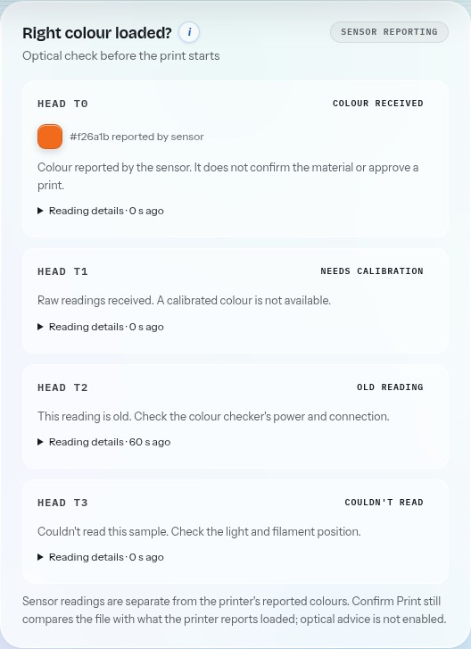

# Colour-checker companion API, version 1

Deja Vu1 can receive colour-sensor observations from a separate companion device. This is the
software contract for that device. No Pico firmware, sensor driver, calibration procedure or
physical accuracy result ships with it yet. The tests use synthetic messages and a stand-in printer.

Raw channels stay raw. A companion may also report a colour, calibration reference and confidence.
Those are the companion's claims, not a calibration verified by Deja Vu1. They do not identify
material, measure transmission distance, approve a print or block one. Confirm Print continues to
check the file against the colours and materials the printer reports loaded.



These are synthetic API messages shown alongside a Moonraker stand-in, not physical sensor readings.

## Connection and access

Enable **Right colour loaded?** in Settings, Optional extras. Select an added physical printer. Every
request below names that printer with `?printer=<id>`; find its ID in `GET /api/fleet/registry`.
Demo printers refuse assignments and incoming observations, even with `demo=1`.

Use the dashboard's existing local address and port. Requests pass the same Host, Origin and
optional device-lock checks as the rest of the dashboard; no sensor header bypasses them. With the
device lock on, the companion must pair through `/api/pairing/redeem` and retain its `dv_device`
cookie, just like another device. Keep that cookie private. Cross-site browser writes are refused.
Do not expose the dashboard or this API directly to the internet.

## Assign a sensor channel

`POST /api/colorcheck/sensors?printer=<id>` with JSON:

```json
{
  "version": 1,
  "simulated": false,
  "bindings": [
    {
      "toolhead": "T0",
      "device_id": "pico-1",
      "channel_id": "inlet-0",
      "sensor_id": "as7341-1",
      "sensor_model": "AS7341"
    }
  ]
}
```

This replaces this printer's complete list, with at most one channel for each of T0 to T3.
An empty list disconnects all its sensors. Assignments survive restart in `colour_sensors.json`.
A device/channel pair can belong to only one head on one printer. Moving it requires removing its
old assignment first. Replacing a chip requires updating `sensor_id`; a mismatched identity is
refused rather than silently taking over the previous sensor's calibration.
Assignments for a deleted printer are cleared on the next assignment save so its channels can be
used again. A registered printer that is temporarily offline keeps its assignments.

IDs and the model name use 1 to 64 letters, digits, dots, colons, hyphens or underscores, beginning
with a letter or digit. Use stable, non-personal identifiers. The companion must keep the same
sensor ID for the same physical chip; the server cannot verify hardware identity by itself.
Any assignment save clears that printer's cached observations, including a save of the same list.
The guided calibration and channel-mapping screen is a later step; this endpoint supports
companion integration today.

## Send an observation

`POST /api/colorcheck/readings?printer=<id>` with JSON:

```json
{
  "version": 1,
  "simulated": false,
  "device_id": "pico-1",
  "channel_id": "inlet-0",
  "sensor_id": "as7341-1",
  "sensor_model": "AS7341",
  "captured_at": 0,
  "raw": {"f1": 100, "clear": 200},
  "quality_flags": [],
  "calibrated": null
}
```

The numbers above are synthetic examples. Replace `captured_at` with the sample's actual capture
time as UTC Unix seconds. Synchronise the companion's clock. A capture more than two seconds in
the future is refused. Delivery time is recorded separately as `received_at` and never renews an
old capture. Repeated or earlier capture times on the same assigned head are refused.

`raw` holds 1 to 16 named, finite, non-negative sensor values, each no greater than 1,000,000,000.
Deja Vu1 does not convert these values to RGB. `quality_flags` is an explicit list of up to 16
identifiers, empty when the companion reports no issue. Examples include `low_light`, `saturated`,
`unstable` and `unsupported_sample`. Any flag, including an unknown one, suppresses the current colour.

When the companion has a calibrated colour, it can replace `calibrated: null` with:

```json
{"hex": "#f26a1b", "calibration_id": "white-dark-1", "confidence": 0.95}
```

All three fields are required. Hex colours have six digits. Confidence is finite and between 0
and 1; values below 0.8 suppress the current colour. This is an initial display policy, not a
measured accuracy threshold. A calibration ID records provenance; it does not prove that the
reference, lighting, housing or sample is suitable. Calibration validation is still to build.

A successful reply has `accepted: true`, `version`, `printer_id`, `toolhead` and the current
`sensor` observation. Invalid messages answer 400 without changing the previous observation.
Disabled modules answer 403. Incoming samples never send a command to a printer.

## Read status

`GET /api/colorcheck/sensors?printer=<id>` returns the configured channels and their statuses,
even while the printer's own network connection is down. No assignments means an empty `sensors`
list. The existing `/api/colorcheck` route also exposes these observations to the colour card when
the printer is connected; its `checks` list stays empty for real printers.

| Status | Meaning |
|---|---|
| `no_reading` | Assigned, but no sample has arrived since start-up or the last assignment save |
| `stale` | Capture is at least 30 seconds old |
| `unreadable` | Companion reported one or more quality flags |
| `uncalibrated` | Raw sample received, with no calibrated colour |
| `low_confidence` | Reported confidence is below 0.8 |
| `reading` | A recent, unflagged, sufficiently confident colour was reported |

Only `reading` has a non-null `detected_hex`. The original raw and calibrated payload remains
under `reading` for inspection, including for an old or rejected-quality sample; it is not a current
measurement. Age uses both capture time and the computer's monotonic clock, so changing the
computer's clock backwards cannot keep a reading current. A stopped companion expires without a
special disconnect message. Restarting Deja Vu1 keeps assignments but discards all observations.
If the dashboard cannot refresh the card, it clears the previous colour and says readings are unavailable.

## Repeat the contract checks

```bash
python3 -m unittest tests.test_companion_sensor tests.test_sanity_check
```

These checks cover synthetic input, the local HTTP routes, printer separation and access checks.
They do not establish the accuracy of a sensor, housing or calibration.
