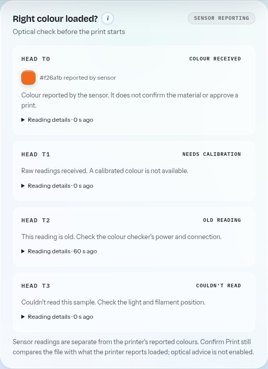

# Colour-checker companion API, version 1

Deja Vu1 can receive colour-sensor observations from a separate companion device. This is the
software contract for that device. No Pico firmware, sensor driver or physical accuracy result ships
with it yet. The tests use synthetic messages and a stand-in printer.

Raw channels stay raw. A companion can send raw counts only: once a head has a white reference
recorded in Deja Vu1 (see Calibrate a sensor), Deja Vu1 works out the colour and keeps it with
`source: "deja-vu1"` and the calibration's ID. A companion can instead report its own colour,
calibration reference and confidence; those are the companion's claims and are kept as sent. A colour
does not identify a material, measure transmission distance, approve a print or block one. Confirm
Print shows the sensor's colour beside the file's colour and the printer's report (see Confirm Print)
and still decides from the file and what the printer reports loaded.



These are synthetic API messages shown alongside a Moonraker stand-in, not physical sensor readings.

## Connection and access

Enable **Right colour loaded?** in Settings, Optional extras. Select an added physical printer. Every
request below names that printer with `?printer=<id>`; find its ID in `GET /api/fleet/registry`.
Demo printers refuse assignments and incoming observations, even with `demo=1`.

Use the dashboard's existing local address and port. Requests pass the same Host, Origin and
optional device-lock checks as the rest of the dashboard; no sensor header bypasses them. With the
device lock on, the companion must pair through `/api/pairing/redeem` and retain its `dv_device`
cookie, just like another device. Keep that cookie private. Cross-site browser writes are refused.
Do not expose the dashboard or this API directly to the internet.

## Assign a sensor channel

`POST /api/colorcheck/sensors?printer=<id>` with JSON:

```json
{
  "version": 1,
  "simulated": false,
  "bindings": [
    {
      "toolhead": "T0",
      "device_id": "pico-1",
      "channel_id": "inlet-0",
      "sensor_id": "as7341-1",
      "sensor_model": "AS7341"
    }
  ]
}
```

This replaces this printer's complete list, with at most one channel for each of T0 to T3.
An empty list disconnects all its sensors. Assignments survive restart in `colour_sensors.json`.
A device/channel pair can belong to only one head on one printer. Moving it requires removing its
old assignment first. Replacing a chip requires updating `sensor_id`; a mismatched identity is
refused rather than silently taking over the previous sensor's calibration.
Assignments for a deleted printer are cleared on the next assignment save so its channels can be
used again. A registered printer that is temporarily offline keeps its assignments.

IDs and the model name use 1 to 64 letters, digits, dots, colons, hyphens or underscores, beginning
with a letter or digit. Use stable, non-personal identifiers. The companion must keep the same
sensor ID for the same physical chip; the server cannot verify hardware identity by itself.
Any assignment save clears that printer's cached observations, including a save of the same list.
Calibration is under Calibrate a sensor below. A screen that tests each channel before first use is
a later step.

## Send an observation

`POST /api/colorcheck/readings?printer=<id>` with JSON:

```json
{
  "version": 1,
  "simulated": false,
  "device_id": "pico-1",
  "channel_id": "inlet-0",
  "sensor_id": "as7341-1",
  "sensor_model": "AS7341",
  "captured_at": 0,
  "raw": {"f1": 100, "clear": 200},
  "quality_flags": [],
  "calibrated": null
}
```

The numbers above are synthetic examples. Replace `captured_at` with the sample's actual capture
time as UTC Unix seconds. Synchronise the companion's clock. A capture more than two seconds in
the future is refused. Delivery time is recorded separately as `received_at` and never renews an
old capture. Repeated or earlier capture times on the same assigned head are refused.

`raw` holds 1 to 16 named, finite, non-negative sensor values, each no greater than 1,000,000,000.
Deja Vu1 does not convert these values to RGB. `quality_flags` is an explicit list of up to 16
identifiers, empty when the companion reports no issue. Examples include `low_light`, `saturated`,
`unstable` and `unsupported_sample`. Any flag, including an unknown one, suppresses the current colour.

When the companion has a calibrated colour, it can replace `calibrated: null` with:

```json
{"hex": "#f26a1b", "calibration_id": "white-dark-1", "confidence": 0.95}
```

All three fields are required. Hex colours have six digits. Confidence is finite and between 0
and 1; values below 0.8 suppress the current colour. This is an initial display policy, not a
measured accuracy threshold. A calibration ID records provenance; it does not prove that the
reference, lighting, housing or sample is suitable. Only a bench test on known colours shows that.

A successful reply has `accepted: true`, `version`, `printer_id`, `toolhead` and the current
`sensor` observation. Invalid messages answer 400 without changing the previous observation.
Disabled modules answer 403. Incoming samples never send a command to a printer.

## Read status

`GET /api/colorcheck/sensors?printer=<id>` returns the configured channels and their statuses,
even while the printer's own network connection is down. No assignments means an empty `sensors`
list. The existing `/api/colorcheck` route also exposes these observations to the colour card when
the printer is connected; its `checks` list stays empty for real printers.

| Status | Meaning |
|---|---|
| `no_reading` | Assigned, but no sample has arrived since start-up or the last assignment save |
| `stale` | Capture is at least 30 seconds old |
| `unreadable` | Companion reported one or more quality flags |
| `uncalibrated` | Raw sample received, with no calibrated colour |
| `low_confidence` | Reported confidence is below 0.8 |
| `reading` | A recent, unflagged, sufficiently confident colour was reported |

Only `reading` has a non-null `detected_hex`. The original raw and calibrated payload remains
under `reading` for inspection, including for an old or rejected-quality sample; it is not a current
measurement. Age uses both capture time and the computer's monotonic clock, so changing the
computer's clock backwards cannot keep a reading current. A stopped companion expires without a
special disconnect message. Restarting Deja Vu1 keeps assignments but discards all observations.
If the dashboard cannot refresh the card, it clears the previous colour and says readings are unavailable.

## Calibrate a sensor

Deja Vu1 calibrates the AS7341 and the TCS34725. A companion for the AS7341 sends the channels
`f1` to `f8` (415, 445, 480, 515, 555, 590, 630 and 680 nm); one for the TCS34725 sends `r`, `g` and
`b`. Other raw names, such as `clear` and `nir`, are stored and not used. Any other sensor model has to
report its own colour.

1. Put a white target in the housing where the filament goes, with the sensor's light on, and wait for
   a new reading.
2. `POST /api/colorcheck/calibration?printer=<id>` with `{"toolhead": "T0", "step": "white"}`.
3. Optional: empty the housing, wait for a reading, and send `{"toolhead": "T0", "step": "dark"}`. It
   removes the sensor's own offset and helps dark colours.
4. `{"toolhead": "T0", "step": "clear"}` forgets both references.

The reply is the head's calibration: `state` (`none`, `needs_white`, `ready` or `unsupported`), `id`
(`dv1-` and eight characters that change whenever a reference changes), whether a white and a dark
reference exist, and a sentence saying what to do next. The same block is under `calibration` for each
sensor in `GET /api/colorcheck/sensors`. The Right colour loaded? card has buttons for the three steps.

A reference is taken from the head's latest reading, which must be under 5 seconds old and carry no
quality flag, so the target is in place when it is recorded. A dark reference that is not darker than
the white one, a missing channel or an unsupported model answers 400 in words and changes nothing.
Replacing the chip (`sensor_id`), moving the channel or removing the assignment drops that head's
calibration at once; a deleted printer's calibrations go with its assignments on the next assignment save.
Saving the same assignment again keeps the calibration. Calibration needs the
Right colour loaded? module and a physical printer; demo printers answer 400.

How it works: each channel is divided by its white reference after the dark one is subtracted. The
TCS34725's three ratios are the colour's linear red, green and blue. For the AS7341 the eight ratios
are joined into a spectrum, weighted by a daylight-like light and the CIE 1931 colour-matching curves
(the multi-lobe fit in Table 1 of Wyman, Sloan and Shirley, *Journal of Computer Graphics Techniques*
2(2), 2013) and converted to sRGB. The white target maps to white. A sample more than 1.3 times as
bright as the white target in any channel means the set-up moved: it gets confidence 0.5 and no current
colour.
Otherwise confidence is 0.9. Both are display settings, as for a companion's own value, and are not
measured accuracies. The tests check this arithmetic against known spectra and the rules around it;
they do not show how close a physical sensor comes to a spool's colour.

## Confirm Print

For each head the file uses that has an assigned sensor, Confirm Print shows three colours apart: what
the file expects, what the printer reports loaded, and what the sensor reads (`measured` in
`GET /api/print/confirm`, with `versus_file` as `match`, `close` or `mismatch`). A mismatch adds a warning
that asks for a look at the spool, or at which head the sensor is assigned to when the printer already
reports the file's colour. A sensor with no current colour adds a note. None of this blocks a start or
changes the printer's own checks. A head with no sensor shows nothing extra. Demo printers show a
labelled simulation, the same every time, with no warnings.

A start that goes ahead after a sensor mismatch is recorded: `GET /api/colorcheck/overrides?printer=<id>`
lists the newest 50, each with the file, the file's, the printer's and the sensor's colour per head, the
distance and the calibration used.

## Repeat the contract checks

```bash
python3 -m unittest tests.test_companion_sensor tests.test_sensor_calibration tests.test_sanity_check
```

These checks cover synthetic input, the local HTTP routes, printer separation, access checks, the
calibration arithmetic and rules, and the Confirm Print advice. They do not establish the accuracy of a
sensor, housing or calibration. `node tools/browser-walk.js --flows-only --flow sensor` runs the
calibration button and Confirm Print in a browser against `tools/stand-in-printer.py`.
