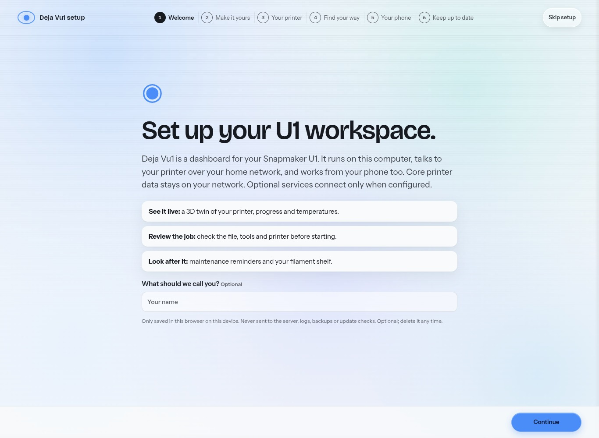

# Copy changes in PR #52

This is an edited set of public-facing descriptions and selected app copy. It
is not an app-wide rewrite and is not an AI-detector pass. The aim is natural,
specific language that tells a U1 owner what they can do and what is verified.
The public disclosure of AI-assisted coding remains in the README.

| Surface | Before | After / reason |
|---|---|---|
| README introduction | A long category description followed by a feature list | Starts with seeing the printer that needs attention, preparing a plate and reviewing its layers/checks; explains local operation and the separate engine |
| Product-page introduction | Monitoring, slicing and server checks listed in technical terms | Short user actions, a visible demo button and an explicit first-connection invitation |
| Search/share metadata | General dashboard/workspace wording | Names Snapmaker U1 and the task; share descriptions identify the simulated demo |
| App manifest | A long list including recovery | A compact description of attention, preparation and review; keeps the separate-engine requirement |
| Onboarding privacy | “Nothing goes to the cloud.” | Core printer data stays local; configured services can connect |
| Onboarding print point | “Stay safe” | “Review the job,” with file, tool and printer checks; avoids implying a safety certification |
| Onboarding titles | “A little setup. A clearer print day.” / “Your bench. In your pocket.” | “Set up your U1 workspace.” / “Open it on your phone.” |
| Phone card | “No account, no cloud.” | Open the computer’s address on the same Wi-Fi; no app account, pairing optional |
| Automation form | “When this happens, do that… no cloud.” | Choose an event and action; rules run on the computer and notifications use configured services |
| Update-speed claim | Every printer updates four times a second | A 250 ms server-loop target; actual freshness depends on printer/network |
| Conversion claim | Projects convert in one click | Supported projects and selected plates; vendor paint/texture limits remain explicit |
| Filament claim | A mismatch blocks, without explaining missing data | Known mismatches block; unavailable information stays unknown and asks for a visual check |
| Hardware descriptions | Proposed rings and sensor could read as available | Driver and physical-validation gaps are explicit |
| Core setup | “Python… Nothing else.” | Python for the core; slicing, camera and remote-access tools can have separate requirements |
| Image alternatives | Some descriptions named old counts, old geometry or exact transient readings | Descriptions match the current visual and its evidence; malformed quoted attributes were repaired |
| Promotional drafts | Descriptions spread across launch notes | One reviewable set of repository, project/Phase 2, community, social and video copy in `marketing-library/COPY.md` |

The campaign uses short, concrete hooks without invented experience, testimonials
or measurements. It distinguishes conceptual art, actual app screenshots,
simulated readings and historical Linux engine evidence. No AI-assisted
provenance is hidden. Technical instructions and most operational app strings
retain their existing wording; they were not all rewritten or certified.

The repository description and GitHub preview are supplied as files because
repository settings are outside a code PR. No social post, application form or
repository setting was changed. Existing versioned films were preserved.

