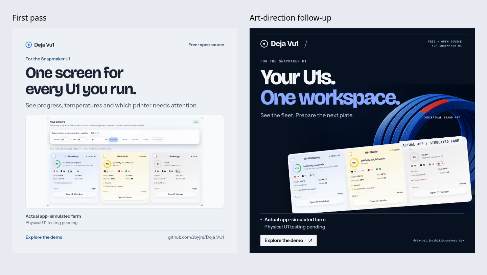
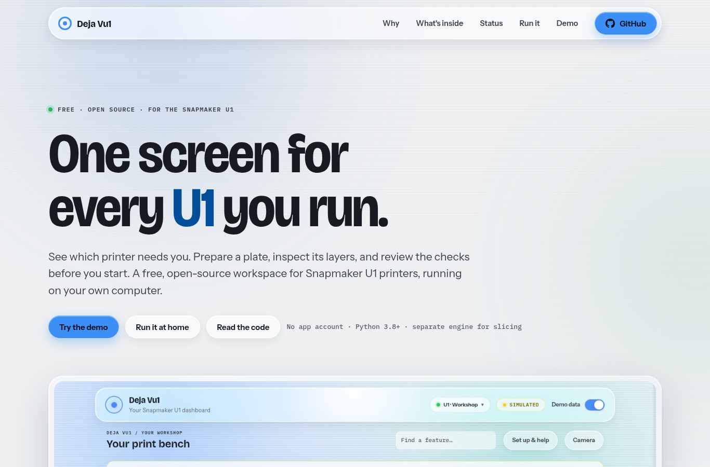
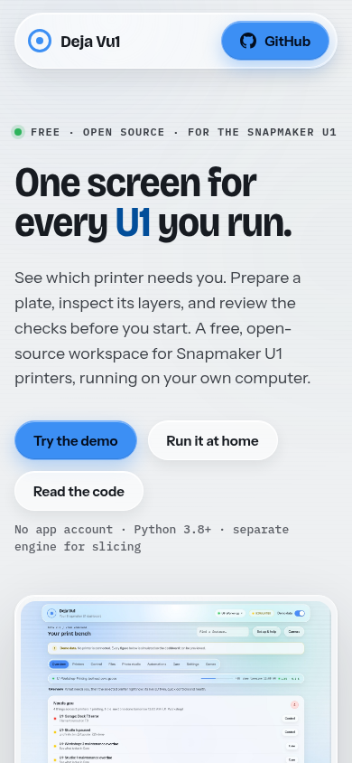

# Public copy and image review

Review build, 23 October 2026; campaign art-direction follow-up included. The product page, README, metadata, share card,
editorial screenshots, explainer boards and campaign copy now use consistent
claims. The landing page matches the dashboard’s blue accent and gives the
preparation workspace and twin dedicated images.

| Material | Location |
|---|---|
| Product page | `frontend/welcome.html` |
| Share card | `frontend/img/social-card.png` |
| Campaign | [24 cards, captions and alternatives](../marketing-library/09-current-campaign/) |
| Descriptions and posts | [Copy ready for review](../marketing-library/COPY.md) |
| Claim limits | [Project messaging](../marketing-library/MESSAGING.md) |
| Capture evidence | [Capture record](../marketing-library/capture-record.json) |
| Copy consistency | [Asset paths and hashes](../marketing-library/current-assets.json) |
| Reproduction | [Capture/render guide](../tools/readme-images/README.md) |

## Campaign redesign

The follow-up replaces the repeated pale-card template with six art-directed
compositions. The loop illustration supplies a recurring brand element, while
actual UI crops show the product’s relevant detail. The blue loop is AI-generated
conceptual artwork, not a physical accessory or print result. Product evidence,
simulation labels and unverified hardware remain explicit.

The pack now has 24 exports: six subjects in square, 4:5 portrait, 16:9 landscape
and native 1200 × 628 horizontal-feed formats. The message/use guide explains
which action each image supports. No paid ads or performance experiment ran.

## Browser review

Current product page at 1366 px:

Current product page at 390 px:

The browser check passed at both widths: local images decode, section links
resolve, the demo button opens the recorded farm, no horizontal overflow and
no uncaught JavaScript errors. The separate static-demo check passed G-code
layer navigation, three-plate choices and the refusal of writes that require
the local app. These are Chromium viewport checks, not real-phone tests.

The campaign was subsequently redesigned with distinct compositions,
an explicitly conceptual loop illustration and a native horizontal-feed export.
[Message and placement guide](../marketing-library/AD-GUIDE.md) ·
[Exact copy scope and examples](copy-review.md).

The campaign renderer checked all 24 output sizes for missing images,
out-of-bounds copy, evidence/action overlap, authored text palette contrast
and the reviewed feed file-size limit. Visual review checked their composition and evidence labels;
these automated bounds checks are not an accessibility certification.

## Software validation

- `python3 -m unittest discover tests`: **771 passed in 135.066 seconds**,
  Python 3.12.14/Linux, app/demo servers stopped.
- Two focused API asset checks passed: shipped page assets and bundled share-card
  URL/type/dimensions.
- `check-marketing.js` and `tools/check-static-demo.js`: desktop and phone checks
  passed with no page errors or horizontal overflow.
- All 109 current asset hashes and the 24 export dimensions passed.
  Both share images are below GitHub’s reviewed 1 MB preview limit.
- `git diff --check`: passed.

No new engine run or physical printer test was performed. Historical Linux
engine captures retain that provenance. Current farm imagery uses an isolated
simulator; Add a printer uses a source-based stand-in Moonraker on loopback.
The twin remains a software model with partly estimated geometry.

## Review boundaries

The repository description, GitHub social-preview candidate, Phase 2 description
and social/video posts are supplied as reviewable files. No repository settings,
application form or social account was changed. Existing version 12–15 films and
icons are retained. The library separates these historical films/cards from the
current standalone campaign. No detector, conversion uplift or award-score
measurement is claimed. No merge is authorized by this review.
