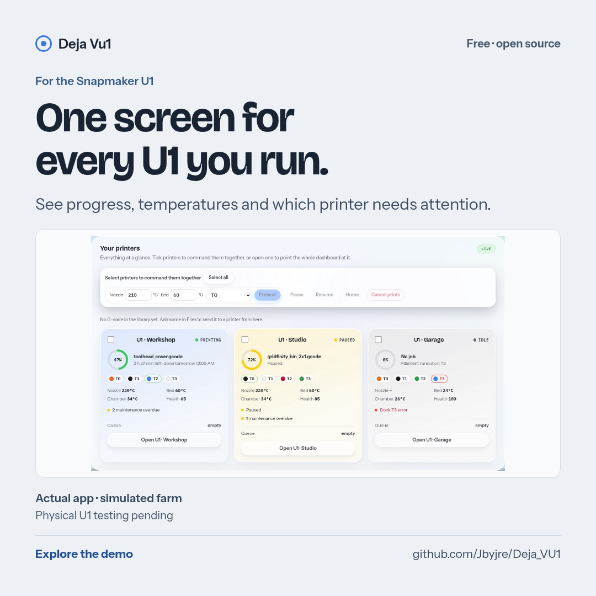
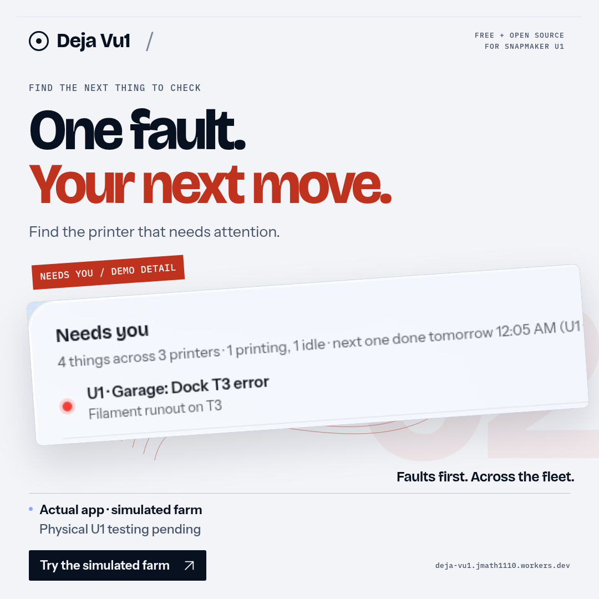
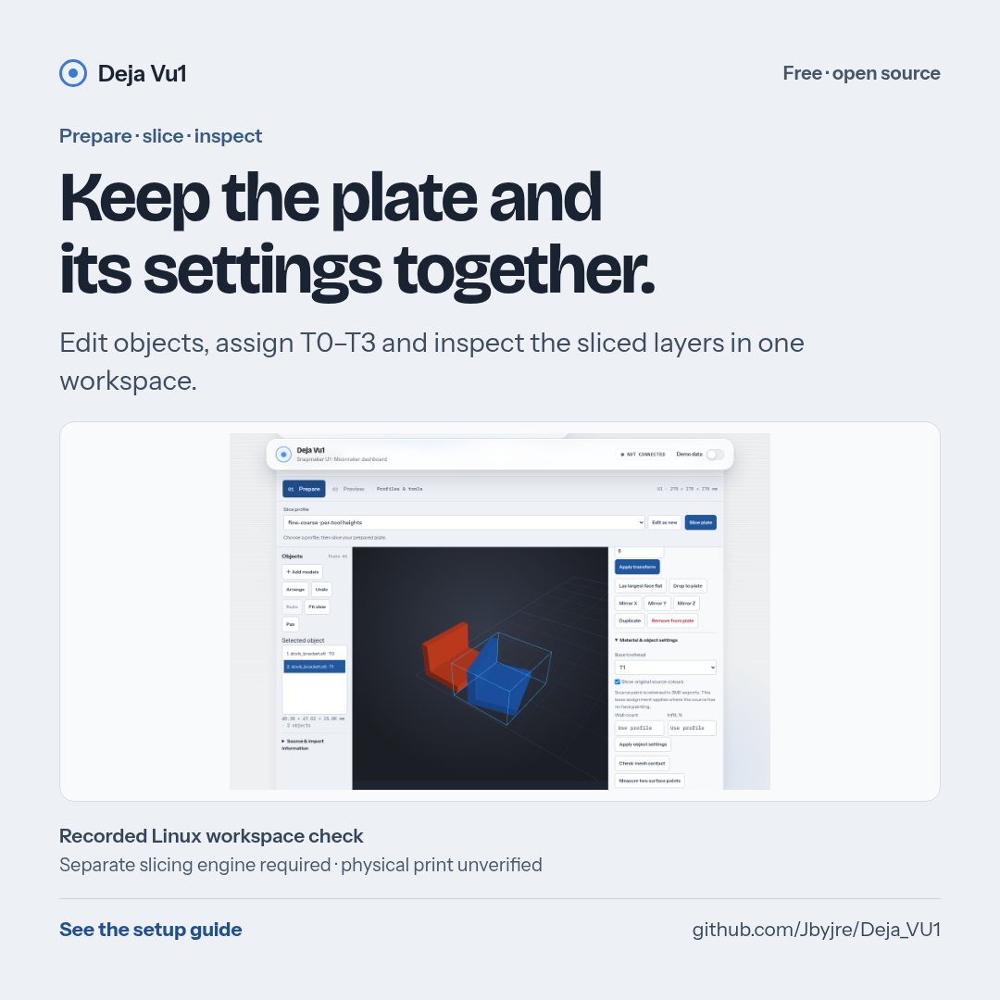
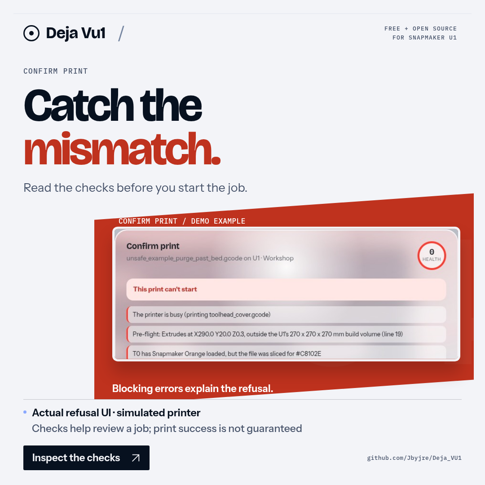
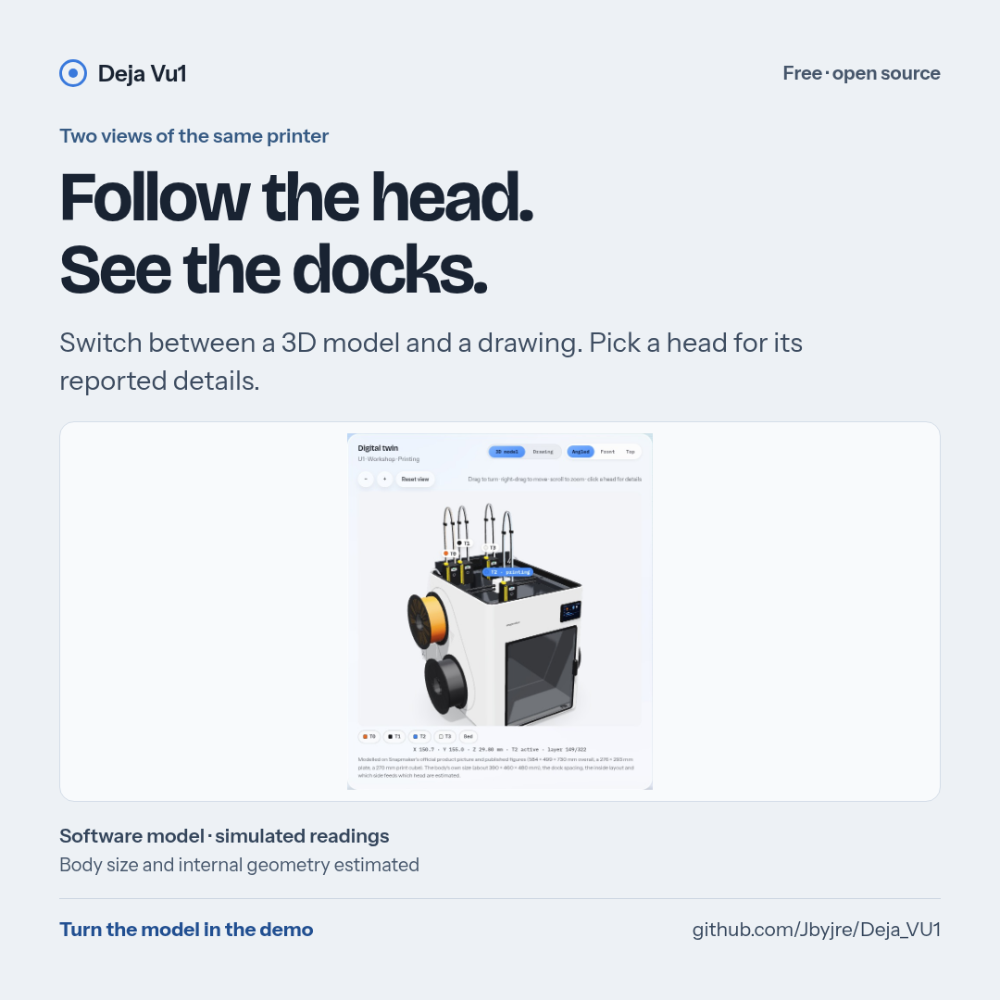
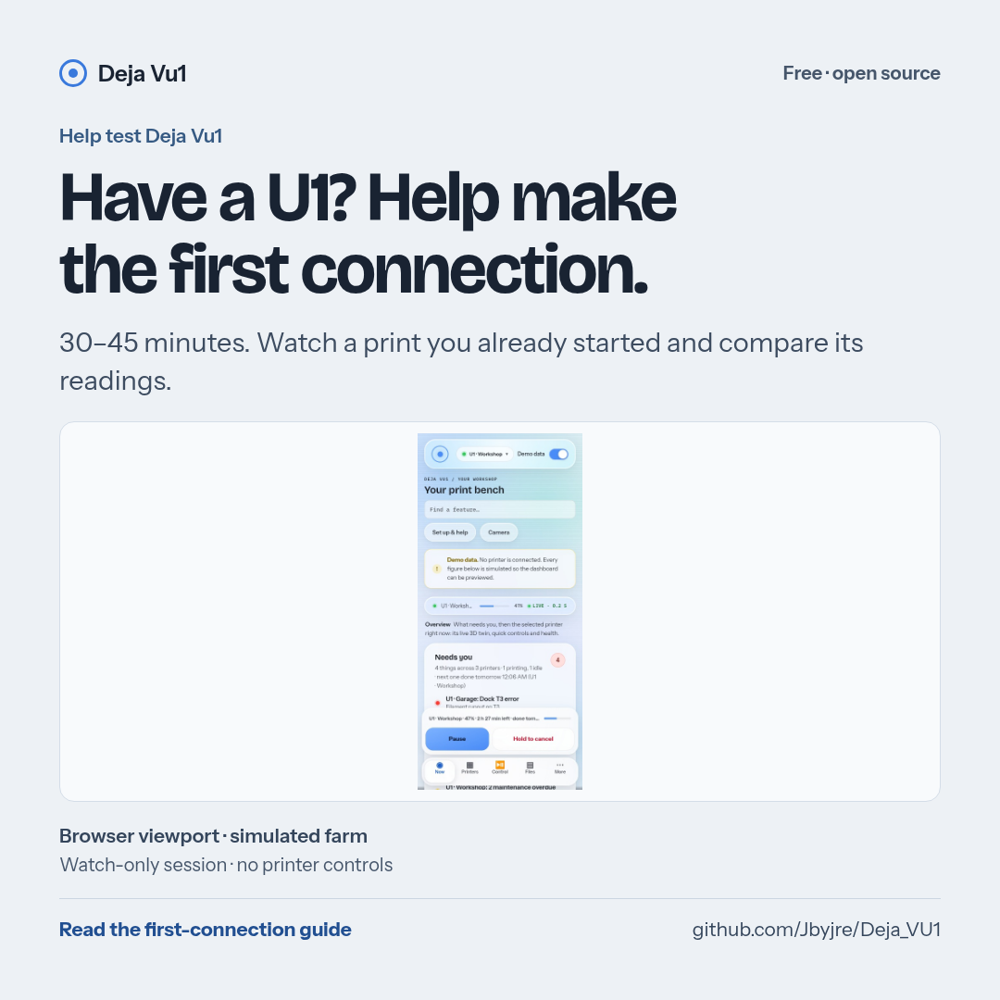

# Marketing library

Review copy of Deja Vu1’s public materials. This folder is temporary and is
removed before the launch post; the live app reads its images from `frontend/img/`
and the README uses `docs/img/`. Nothing has been posted or submitted from here.

Start with [AD-GUIDE.md](AD-GUIDE.md) for message/placement choices,
[COPY.md](COPY.md) for descriptions and posts, and
[MESSAGING.md](MESSAGING.md) for the claim limits. Open an image on GitHub and use
Download to save it, or download the repository ZIP for the complete pack.

## Current campaign · 23 October 2026

Six subjects in four formats: landscape **1600 × 900**, square
**1080 × 1080**, portrait **1080 × 1350**, and horizontal feed **1200 × 628**. These are independently typeset cards,
not crops of a video. Every card carries its own evidence label and limitation.
[Captions and alt text](09-current-campaign/captions.json) are included as plain text.

| Subject | Preview | Downloads |
|---|---|---|
| Fleet |  | [Landscape](09-current-campaign/01-fleet-landscape.png) · [Square](09-current-campaign/01-fleet-square.png) · [Portrait](09-current-campaign/01-fleet-portrait.png) · [Feed](09-current-campaign/01-fleet-feed.png) |
| Needs you |  | [Landscape](09-current-campaign/02-needs-you-landscape.png) · [Square](09-current-campaign/02-needs-you-square.png) · [Portrait](09-current-campaign/02-needs-you-portrait.png) · [Feed](09-current-campaign/02-needs-you-feed.png) |
| Prepare |  | [Landscape](09-current-campaign/03-prepare-landscape.png) · [Square](09-current-campaign/03-prepare-square.png) · [Portrait](09-current-campaign/03-prepare-portrait.png) · [Feed](09-current-campaign/03-prepare-feed.png) |
| Print checks |  | [Landscape](09-current-campaign/04-print-checks-landscape.png) · [Square](09-current-campaign/04-print-checks-square.png) · [Portrait](09-current-campaign/04-print-checks-portrait.png) · [Feed](09-current-campaign/04-print-checks-feed.png) |
| Digital twin |  | [Landscape](09-current-campaign/05-digital-twin-landscape.png) · [Square](09-current-campaign/05-digital-twin-square.png) · [Portrait](09-current-campaign/05-digital-twin-portrait.png) · [Feed](09-current-campaign/05-digital-twin-feed.png) |
| First connection |  | [Landscape](09-current-campaign/06-first-connection-landscape.png) · [Square](09-current-campaign/06-first-connection-square.png) · [Portrait](09-current-campaign/06-first-connection-portrait.png) · [Feed](09-current-campaign/06-first-connection-feed.png) |

## Share image and explainers

[1200 × 630 link preview](01-main-image/link-preview-card-1200x630.png) is the
bundled card used by the product page, dashboard metadata and README.
[1280 × 640 GitHub preview](01-main-image/github-social-preview-1280x640.png) is
ready for the repository’s Settings → Social preview. That setting is external
to a PR and has not been changed.

The [five explainer boards](02-explainer-boards/) cover workflow scope, Confirm
Print, local connections, code limits and proposed dock status. The workflow
board replaces the old feature-count collage. Counts describe code or software
checks, not hardware certification. Dock-ring drivers remain unfinished.

## Screenshots and provenance

The main editorial images in [03-screenshots](03-screenshots/) and current twin
views in [04-digital-twin](04-digital-twin/) are captures of the actual app on an
isolated simulated farm. [capture-record.json](capture-record.json) lists exactly
which images were recaptured and what each shows.
[current-assets.json](current-assets.json) records shipped paths, source files
and hashes to check that copies match. Phone pictures are Chromium
viewports, not photographs or real-device tests. The twin is a software model;
its body size and internal geometry are estimates.

The `slicer-after-*`, process and recovery images retain their recorded Linux
validation provenance. They have **not** been relabelled as fresh engine runs.
See [the validation record](../docs/slicer-workspace-validation.md) for their
source, tested engines and limits. The current `demo-layer-preview.jpg` uses a
built-in sample G-code file, not a new real-engine result.

Files absent from the capture record are older references. In particular,
`twin-3d-dock-fault.jpg`, old setup captures, and the older
video-extracted cards should not be used as current campaign evidence without
review. An image showing a stand-in printer never establishes a physical U1.

## Existing films and animation

[07-videos](07-videos/) holds the films. **Use version 17.** The owner (25 October 2026)
set aside the "V2" films (v13 and v15) and every 9:16 cut; they stay here as history
only, not for posting. ChatGPT-made videos are set aside too (none are in this folder).

| Files | Version |
|---|---|
| `deja-vu1-launch-v17-60s-16x9.mp4` | **v17, current.** v16 made smoother (measured frame by frame), with what changed since: your phone from anywhere, updates that install every time, help on every card |
| `deja-vu1-launch-v16-60s-16x9.mp4` | v16, V1 at 60 s, 16:9 only: the 3DBenchy, the quick tour and scanning onto a phone |
| `deja-vu1-launch-v1-60s-16x9.mp4`, `deja-vu1-launch-v1-60s-9x16.mp4` | v14, V1 cut to 60 s with newer twin/background (9:16 set aside) |
| `deja-vu1-launch-16x9.mp4`, `deja-vu1-launch-9x16.mp4` | v12, 75 s, original V1 (9:16 set aside) |
| `deja-vu1-launch-60s-16x9.mp4`, `deja-vu1-launch-60s-9x16.mp4` | v13, 60 s, original V2 (set aside) |
| `deja-vu1-launch-v2-60s-16x9.mp4`, `deja-vu1-launch-v2-60s-9x16.mp4` | v15, V2 updated (set aside) |

Each film's on-screen counts and claims belong to its version (v17 shows 903
automated tests, counted on 26 October 2026; v16 showed 867, counted on 25 October). Use the new campaign cards for
current standalone graphics and COPY.md for the reviewed video description.
[08-feature-cards](08-feature-cards/) contains video-derived cards (`v17-60s/` from v17, `v16-60s/` from v16);
it is not the current campaign pack. [05-animation](05-animation/) retains the
simulated-jam and layer-preview GIFs; these are demonstrations, not physical prints.

Keep the existing film music credit in the description:
“Piano: Salamander Grand Piano by Alexander Holm, CC BY 3.0.”

## Recreate and review

The [capture guide](../tools/readme-images/README.md) explains source captures,
rendering, copying and browser checks. [06-app-icon](06-app-icon/) contains the
existing brand icons; the brand mark is retained. Public material must preserve
the distinction between simulated data, engine estimates and physical evidence.
